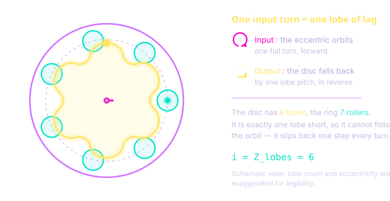
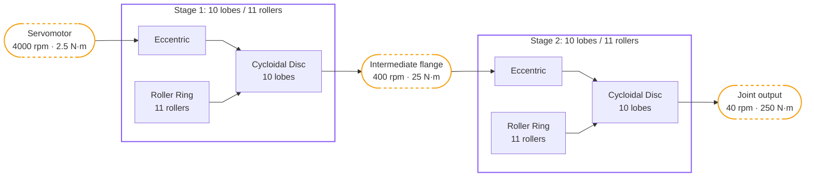
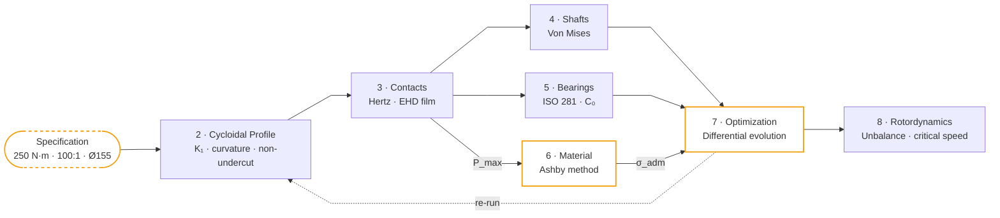

# 1\. Overview

## 1.1. The Target Application

The subject of this project is the **shoulder joint (J2) of a KUKA KR 10**, a six-axis industrial robot with a 10 kg payload. J2 is the most loaded joint of the robot. It carries the whole outboard structure (upper arm, wrist, end effector and payload) against gravity, and the lever arm grows as the arm extends. The other joints carry less mass or work closer to their own axis.

The reducer of this joint has three main requirements:

- **High torque density**, because the mass of the reducer is part of the load the joint has to lift.
- **Radial compactness**, because the joint envelope is imposed by the arm casting.
- **High stiffness and low backlash**, because any lost motion at J2 is amplified by the length of the arm at the tool tip.

These three requirements drive the design choices described in the following pages.

## 1.2. Why a Cycloidal Drive

Three architectures are realistic for a joint of this class.

| Criterion | Planetary | Harmonic drive | **Cycloidal** |
| :--- | :--- | :--- | :--- |
| Torque density | Medium | High | **High** |
| Ratio per stage | 3-10 | 50-160 | **~10** |
| Torsional stiffness | High | Medium (flexspline) | **High** |
| Shock tolerance | Medium | Low | **High** |
| Backlash | Medium | Very low | **Low** |
| Cost / manufacturability | Low | High | **Medium** |

The harmonic drive reaches the required ratio in a single stage, but its flexspline is the compliant element of the chain and handles overloads poorly. This is a problem on an axis exposed to collisions. The planetary train is robust and cheap, but a ratio of 100 needs at least two stages at the top of their range, and three in practice, which adds axial length and reduces stiffness.

The cycloidal drive reaches the target ratio in **two compact stages**. It is stiff because the load is shared by about half of the rollers at the same time, instead of one or two teeth, and this load sharing also makes it tolerant to shocks. Its main drawback is the machining precision required: the disc profile is a complex curve, which is the subject of the next page.

## 1.3. The Kinematic Principle

The mechanism is based on one idea: **the disc has one lobe less than the ring has rollers**.

An eccentric on the input shaft drives the cycloidal disc along a circular orbit of radius $e$ around the central axis. The ring of rollers is fixed, and the lobes of the disc stay in contact with it. Since the disc has one lobe less than the number of rollers, it does not come back to the same angular position after one orbit: it has turned by **one lobe pitch**, in the direction opposite to the input.

With $z_c$ the number of lobes and $z_p = z_c + 1$ the number of rollers, the disc turns by $-1/z_c$ of a revolution per input revolution. The reduction ratio of one stage is therefore:

$$
i = z_c
$$

The ratio is equal to the number of lobes, and it is obtained with a single moving part, without a gear train.

This result holds because the ring of rollers is fixed and the output is taken from the disc.

One input turn = one lobe of lag

- ↻Input: the eccentric makes one full turn
- ↺Output: the disc turns back by one lobe pitch
- Fixed rollers: 7 rollers for 6 lobes

The disc has one lobe less than the ring has rollers, so it cannot follow the orbit: it moves back by one lobe at every input turn. Here $i = z_c = 6$.

Two consequences are used later in the documentation:

- The output rotates **in the opposite direction** to the input, and it is taken from the disc, which is itself orbiting. Output pins convert this orbital motion into a pure rotation (see the vocabulary in section 1.5).
- The disc is an offset mass that orbits at the speed of the input shaft. It creates a rotating unbalance, which is one reason to keep the eccentricity $e$ as small as possible.

## 1.4. Design Specification

The specification is fixed before any sizing. All the following pages use these values.

| Parameter | Value | Origin |
| :--- | :--- | :--- |
| Nominal output torque | 250 N·m | J2 static load, arm extended, with payload |
| Input speed | 4 000 rpm | Brushless servomotor operating point |
| Overall reduction ratio | 100 : 1 | Motor speed to joint speed |
| Maximum outer diameter | 155 mm | Arm casting envelope |
| Axial budget | 40 mm | Of which 10 mm for the inter-stage flange |
| Safety factor | $s = 2$ | Dynamic duty with shocks |
| Minimum bearing life | $L_{10} \geq 500$ h | Service interval target |

These values were compared with commercial robot joint reducers of similar size like the Nabtesco RV series, to check that the torque and envelope targets are realistic.

## 1.5. The Architecture

A ratio of 100 requires two stages. With $i = z_c$, a single stage would need 100 lobes, and for a given outer diameter the lobes would be too small to give a usable contact geometry. The ratio is therefore split between **two stages of the same architecture**, each with **10 lobes and 11 rollers**, which gives $10 \times 10 = 100$.

They share the same roller pitch diameter and the same roller reference, so both rings are identical and both stages are sized against the same radial envelope. The other dimensions (eccentricity, output pins, disc width, eccentric bearing) are sized separately for each stage, because stages do not carry the same torque.

The torque increases through the chain while the speed decreases:

The second stage carries the full output torque at one tenth of the input speed, and the first stage carries one tenth of the torque at full speed. The first stage is limited by its speed (bearing life, unbalance of the disc), the second by its load (contact pressure) and by its low speed, which gives a thin lubricant film. This difference appears in all the sizing pages.

<h3>Vocabulary</h3>

The same six components are used throughout this documentation.

| Component | Function |
| :--- | :--- |
| **Eccentric shaft** | Input. Carries the cam of offset $e$ that drives the disc along its orbit. |
| **Cycloidal disc** | Moving profile. Meshes with the rollers and carries the pin bores. |
| **Roller** | Fixed cylinder on the ring. Here, the **outer race of a small ball bearing** mounted on a fixed pin: the race rolls on the profile. |
| **Output pin** | Goes through an oversized bore in the disc and converts the orbital motion into a pure rotation. |
| **Flange** | Carries the output pins and closes each stage. |
| **Housing** | Holds the roller pins and the main bearings, and sets the outer envelope. |

<!-- FIGURE 2 : coupe schématique annotée nommant les six organes -->

Loose needles were the first option for the rollers, but they need circumferential retention and U-shaped flanges that are hard to size and to machine. **Small ball bearings mounted on fixed pins** avoid the cage,and each roller is positioned by a simple bore in the housing. The roller diameter is then no longer a continuous variable: it is a **discrete choice from a bearing catalogue**. This is why the sizing becomes a mixed integer-continuous optimization problem.

## 1.6. The Design Approach

The sizing of this reducer cannot be done step by step, because the dependencies form a loop:

The geometry sets the contact, the contacts set the Hertz pressure, the pressure sets the material requirement, the material sets the admissible pressure, and the admissible pressure constrains the geometry.

Two loops appear in this diagram, and they are the reason a numerical optimizer is used instead of a spreadsheet:

- **The material loop.** The most loaded contact of the reducer is the output pin against its bore in the second-stage disc. Its Hertz pressure sets the surface hardness required for the disc, which sets the steel and its heat treatment. The material is selected outside the optimizer, and the admissible pressures (2 000 MPa for the roller on the disc, 1 800 MPa for the pin in its bore) are given to the optimizer as constants. Adding a discrete material choice inside the continuous optimization would mix two different problems and increase the computation time.
- **The geometry loop.** All the dimensions are coupled through the shared radial and axial envelopes, so none of them can be fixed on its own.

The first attempt was a hand calculation in a spreadsheet, starting from $e = 5$ mm. This gave a curtate coefficient $K_1 \approx 0{,}93$. With $K_1$ this close to 1, the path of the roller centres bends more tightly than the roller itself at the edge of each hollow (8,4 mm against a 15 mm roller radius), so the profile folds over itself and cannot be machined (undercut). The hand calculation showed the constraint but could not solve it. The numerical optimization reduced the eccentricity to 3,0 mm for the first stage and 3,5 mm for the second.

## 1.7. Results at a Glance

| Output | Value |
| :--- | :--- |
| Architecture | 2 stages, 10 lobes / 11 rollers each, ratio 10 × 10 = 100 |
| Roller | 61903 ball bearing, Ø 30 mm, shared between stages |
| Roller pitch diameter | 118 mm (shared between stages) |
| Eccentricity | 3,0 mm (stage 1) / 3,5 mm (stage 2) |
| Radial envelope used | 148 mm of 155 mm available for the roller ring (152 mm with machining margins). Final housing: Ø160 mm |
| Axial envelope used | 34 mm of 40 mm available (38,5 mm in the final CAD) |
| Disc material | 16MnCr5, case-hardened (702 HV surface, core Re 662 MPa) |
| Governing contact | Output pin / bore, stage 2, at 1 043 MPa (admissible 1 800 MPa) |
| Mass of both discs | 725 g (steel), 777 g in the final CAD |
| Housing mass | 614 g (aluminium 7075-T6, final CAD) |

These values come from the optimization described later. The result was then adjusted by hand to use standard output pins and a larger roller pitch diameter (118 mm, above the 110 mm bound of the search), and the design was checked again against all the constraints. All of them are met except one: the lubricant film on the output pins of stage 2, with λ = 0,8 for a target above 1. This is a soft constraint, which means faster wear rather than failure, and it is discussed in the Mechanical Contacts section. The pages can be read in order or separately: each one lists the values it receives and the values it passes on.

The final CAD differs from these values in three places. Each disc is 1 mm wider than computed (11 and 15 mm), so that its eccentric bearing sits 0,5 mm inside each face: the core uses 38,5 mm of the 40 mm budget. The housing measures Ø160 mm, 5 mm above the envelope, because the radial constraint of the optimization covered the roller ring but not the housing wall. The whole reducer is 92 mm long. The CAD and the drawings are on the Results page.
