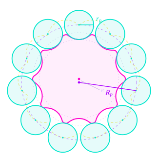
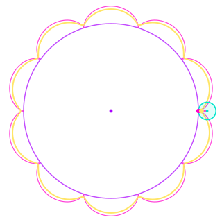
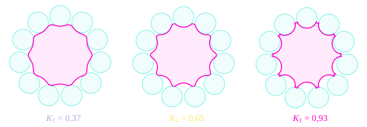
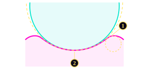
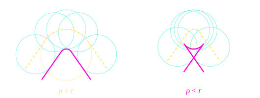
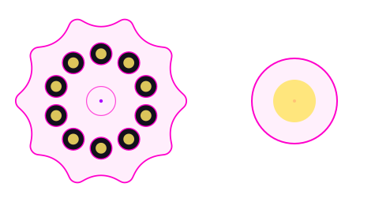
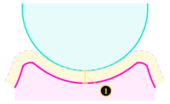

# 2\. Cycloidal Profile

The disc is the central part of the reducer, and its outline is a curve computed from five parameters. This curve decides how the rollers load the disc, how high the contact pressure gets, and whether the part can be machined at all. This page explains where the curve comes from and what each parameter does to it.

The equations follow Qi et al. (2024), *Design principle and numerical analysis for cycloidal drive considering clearance, deformation, and friction*, Alexandria Engineering Journal 91, 403-418.

## 2.1. From the Roller Ring to the Disc Profile

The profile is defined by five parameters. Four of them are shared by both stages (the rollers, their pitch circle and the numbers of lobes and rollers); only the eccentricity is specific to each stage.

| Symbol | Meaning | Stage 1 | Stage 2 |
| :--- | :--- | :--- | :--- |
| $R_p$ | Roller pitch radius: distance from the ring centre to each roller centre | 59 mm | 59 mm |
| $r_p$ | Roller radius (61903 ball bearing, Ø 30 mm) | 15 mm | 15 mm |
| $e$ | Eccentricity: offset between the disc centre and the ring centre | 3,0 mm | 3,5 mm |
| $z_c$ | Number of lobes on the disc | 10 | 10 |
| $z_p$ | Number of rollers on the ring, $z_p = z_c + 1$ | 11 | 11 |

The profile is obtained in two steps:

1. **The path of the roller centres.** Seen from the disc, which orbits and rotates slowly, each roller centre does not stay still: it follows a closed wavy curve around the disc. This curve is an epitrochoid (see section 2.3).
2. **The offset.** A roller is a circle of radius $r_p$ centred on that path. The disc profile is the curve that stays tangent to all these circles, which is the path of the centres moved inward by $r_p$.

Profile anatomy, stage 2

- $R_p$ = 59 mm, roller pitch radius
- Rollers, $r_p$ = 15 mm
- Disc centre
- Ring centre, $e$ = 3,5 mm from the disc centre
- Path of the roller centres
- Disc profile: that path, moved inward by $r_p$
- Root Ø 81 mm and tip Ø 95 mm: the lobe height is $2e$ = 7 mm

Two radius follow directly from this construction and are used on the next pages:

- the **root radius** $R_p - e - r_p$, at the bottom of a hollow, where the disc is thinnest;
- the **tip radius** $R_p + e - r_p$, at the top of a lobe, which sets the disc outer diameter.

The difference between the two is $2e$: the eccentricity directly sets the height of the lobes. With the values above, stage 1 has a root Ø 82 mm and a tip Ø 94 mm, stage 2 a root Ø 81 mm and a tip Ø 95 mm.

## 2.2. The Profile Equation

Qi et al give the profile in the disc coordinate system as a function of a parameter angle $\varphi$, which runs once around the disc and covers all the lobes:

$$
\begin{aligned}
x &= R_p \sin\varphi - e \sin(z_p\varphi) + r_p\,\frac{K_1 \sin(z_p\varphi) - \sin\varphi}{\sqrt{1 + K_1^2 - 2K_1\cos(z_c\varphi)}} \\[4pt]
y &= R_p \cos\varphi - e \cos(z_p\varphi) + r_p\,\frac{K_1 \cos(z_p\varphi) - \cos\varphi}{\sqrt{1 + K_1^2 - 2K_1\cos(z_c\varphi)}}
\end{aligned}
$$

The equation can be interpreted as follow:

- The first two terms, $R_p \sin\varphi - e\sin(z_p\varphi)$ and its cosine counterpart, are the **path of the roller centres**. The first term is a circle of radius $R_p$; the second adds a small circle of radius $e$ that turns $z_p$ times faster, which creates the waves.
- The last term moves each point of that path by a distance $r_p$ along the **inward normal**. The fraction is a unit vector: the square root in the denominator only normalises it.

The coefficient $K_1$ appears in the offset term. It is a combination of the other parameters, and the most useful single number to describe the shape of the disc.

## 2.3. The Curtate Coefficient K₁

$$
K_1 = \frac{e \cdot z_p}{R_p}
$$

The path of the roller centres can be drawn with a rolling circle. A circle of radius $R_p / z_p$ rolls without slipping around a fixed circle, and a point attached to it, at a distance $d$ from its centre, traces the curve. For the roller path, that distance is exactly the eccentricity $e$. $K_1$ is therefore the ratio between the distance of the tracing point and the radius of the rolling circle:

- $K_1 = 1$: the point is on the rim of the rolling circle. The curve is a true epicycloid, with sharp cusps.
- $K_1 < 1$: the point is inside the rolling circle. The curve is smoother and is called *curtate* (shortened), hence the name of the coefficient.

Where $K_1$ comes from

- Fixed circle, radius $R_p \, z_c / z_p$
- Rolling circle, radius $R_p / z_p$ = 5,4 mm
- Point on the rim: $K_1 = 1$, the curve has cusps
- Point at $d = e$ = 3,5 mm: $K_1$ = 0,65, the roller-centre path of stage 2

The yellow curve is the path of the roller centres of stage 2. The disc profile is this curve moved inward by $r_p$.

In practice, $K_1$ measures how deep the lobes are compared with the size of the disc. The design range used in this project is:

$$
0{,}50 \;\leq\; K_1 \;\leq\; 0{,}85
$$

- $e$ = 2 mm: shallow lobes
- $e$ = 3,5 mm: stage 2
- $e$ = 5 mm: first hand calculation, the profile folds at the edge of each hollow

**Below 0,50, the lobes are too shallow.** All the contact forces between the rollers and the disc pass through one point, the pitch point, located at a distance $e \cdot z_c$ from the disc centre. Their lever arm around the disc centre is therefore proportional to $e$: for a given torque, a small $K_1$ means a shorter lever arm and larger forces on the rollers. The force model used for the sizing, in the Mechanical Contacts section, is simpler: it takes an average force with the roller pitch radius as lever arm, so it does not see this effect. The lower bound on $K_1$ makes up for it, by stopping the lever arm from becoming too short.

**Above 0,85, the profile becomes too sharp.** The path of the roller centres bends more and more tightly near the edges of the hollows. Close to $K_1 = 1$, it bends tighter than the roller itself, and the profile folds over itself: this is the undercut described before. The upper bound keeps a margin below that limit.

The retained design gives $K_1 = 0{,}559$ for stage 1 and $K_1 = 0{,}653$ for stage 2, both inside the range. The first hand calculation of the project started from $e = 5$ mm, which gives $K_1 = 0{,}93$. The profile of the figure above shows the result: small folds appear at the edge of each hollow, and the disc cannot be machined.

## 2.4. The Radius of Curvature

The contact between a roller and the disc is a contact between two curved surfaces, and its Hertz pressure depends on the curvature radius of the profile at the contact point. The radius of curvature $\rho$ is given by this formula:

$$
\rho = \frac{\left(1 + K_1^2 - 2K_1\cos(z_c\varphi)\right)^{3/2}}{K_1(1 + z_p)\cos(z_c\varphi) - (1 + z_p K_1^2)}\,R_p \;+\; r_p
$$

The sign gives the shape of the profile:

- $\rho > 0$: the profile is **concave**, it curves around the roller. This is the hollow.
- $\rho < 0$: the profile is **convex**, it curves away from the roller. This is the lobe.

Curvature, stage 2

- 1Lobe shoulder, convex: $\rho$ = −2,7 mm, the tightest point of the profile
- 2Hollow, concave: $\rho$ = +16,2 mm, close to $r_p$ = 15 mm
- Osculating circles (circles with the same curvature as the profile)
- Roller seated in the hollow

| | Stage 1 | Stage 2 |
| :--- | :--- | :--- |
| Hollow (concave) | + 17,2 mm | + 16,2 mm |
| Tightest convex point, on the lobe shoulder | − 4,3 mm | − 2,7 mm |

In the hollow, the radius of the profile is close to the roller radius (15 mm): the two surfaces nearly match, and the pressure there is low. On the shoulder of the lobe, the profile is sharply convex, and a roller that presses there sees a much higher pressure. A larger $K_1$ makes the shoulder sharper, which is a second reason to keep it below its upper bound.

## 2.5. The Undercut Criterion

The profile is the path of the roller centres moved inward by $r_p$. This works as long as the path does not bend more tightly than the roller. Where the path has a convex bend of radius $\rho_{\min}$, the offset curve has a radius $\rho_{\min} - r_p$. If $r_p > \rho_{\min}$, that radius becomes negative: the offset curve crosses itself and forms a small loop. A cutter cannot follow a loop, and the real disc would be cut back by the rollers at that point. This is called **undercut**.

The condition to avoid it is therefore:

$$
r_p \;\leq\; 0{,}9 \cdot \rho_{\min}
$$

where $\rho_{\min}$ is the minimum radius of curvature of the convex parts of the roller-centre path. The factor 0,9 keeps a 10 % margin for manufacturing tolerances.

| | $\rho_{\min}$ | Limit $0{,}9\,\rho_{\min}$ | $r_p$ | Result |
| :--- | :--- | :--- | :--- | :--- |
| Stage 1 ($K_1 = 0{,}559$) | 19,3 mm | 17,4 mm | 15 mm | OK |
| Stage 2 ($K_1 = 0{,}653$) | 17,7 mm | 15,9 mm | 15 mm | OK, 6 % margin |
| Hand calculation ($K_1 = 0{,}93$) | 8,4 mm | 7,6 mm | 15 mm | Undercut |

Stage 2 is close to the limit. With a 30 mm roller on a 118 mm pitch diameter, the rollers are large compared with the disc, and the undercut criterion is one of the constraints that sets the maximum eccentricity.

!!! note "Why not the closed-form criterion"

    The first version of the code used a ready-made formula from Shin and Kwon to detect undercut. This formula is quick to compute, but it is only an approximation, and it plays safe: with rollers as large as the ones used here, it rejected profiles that were actually fine. It was therefore replaced by the direct check described above, which measures how tightly the path of the roller centres bends and compares it with the roller radius. Both the optimization code and the profile generator now use this check.

## 2.6. Output Pins and Bores

The output pins are fixed to the output flange, and each one passes through a bore in the disc. Seen from the flange, the disc does not rotate: it only moves along a circle of radius $e$. Each bore therefore circles around its pin, and for the pin to stay in contact with the bore wall all the way round, the bore must be larger than the pin by exactly the eccentricity (Qi et al, eq. 1):

$$
r_{\text{bore}} = r_{\text{pin}} + e
$$

Output pins, stage 1

- Output pins Ø 6 mm, fixed to the output flange
- Disc bores Ø 12 mm, moving with the disc along a circle of radius $e$ = 3 mm
- Right: zoom on one pin and its bore

With $r_{\text{bore}} = r_{\text{pin}} + e$, the pin stays in contact with the bore wall all the way round.

A smaller bore and the pins jam the orbit. A larger one, and the disc can move without driving the pins, which creates backlash.

| | Stage 1 | Stage 2 |
| :--- | :--- | :--- |
| Output pins | 10 × Ø 6 mm on Ø 52 mm | 12 × Ø 4 mm on Ø 64 mm |
| Bores | Ø 12 mm | Ø 11 mm |
| Ligament between two bores | 4,1 mm | 5,6 mm |

The bores must also leave enough material between them. The width of material left between two neighbouring bores is the distance between their centres, minus one bore radius on each side. It must stay above a minimum machinable value $\delta = 2$ mm:

$$
\underbrace{2\,R_{\text{pin}} \sin\!\left(\frac{\pi}{z_w}\right)}_{\text{distance between bore centres}} \;-\; 2\,r_{\text{bore}} \;\geq\; \delta
$$

with $R_{\text{pin}}$ the pin pitch radius, $z_w$ the number of pins and $\delta = 2$ mm the minimum machinable ligament.

## 2.7. From the Equation to the CAD Model

The profile is generated by a separate Python notebook, not drawn by hand. It evaluates the equation of section 2.2 on 720 points, checks $K_1$ and the undercut criterion, and exports the curve as a closed spline in a DXF file. The file is imported into a sketch in 3DExperience and extruded to the disc thickness.

Two details of this chain matter:

- **Units** : The DXF file declares millimetres explicitly. Without it, 3DExperience reads the coordinates in metres.
- **Machining offsets** : The theoretical profile touches every roller exactly, with zero clearance: the smallest machining error or thermal expansion would jam the disc. The profile is therefore generated as if the rollers were slightly larger ($r_p + 0{,}05$ mm) and placed on a slightly smaller circle ($R_p - 0{,}05$ mm). The machined disc comes out about 0,1 mm smaller at the bottom of each hollow, which leaves a small working clearance with the rollers.

Machining offsets

- Theoretical profile: touches the roller, no clearance
- Machined profile, generated with $R_p - 0{,}05$ mm and $r_p + 0{,}05$ mm
- Working clearance
- 1About 0,1 mm at the bottom of the hollow

The clearance is exaggerated to be visible.

That clearance is the main subject of the article.: it changes how many rollers carry the load, and it creates a small backlash. The sizing of this project uses the nominal geometry and assumes half of the rollers in contact as view in the Mechanical Contacts section, which is a simplification of that behaviour.

!!! note "Two ways to use the same disc"

    the article. study the configuration where the disc is held and the roller ring is the output. The ratio is then $z_p$. This project uses the other configuration, with the roller ring fixed in the housing and the output taken from the disc through the pins, which gives a ratio of $z_c$. The profile equations are the same in both cases; only the ratio changes.

