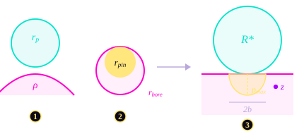
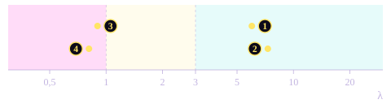
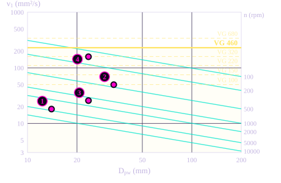

# 3\. Mechanical Contacts

The torque of each stage goes through two kinds of contact: the rollers pressing on the disc profile, and the output pins pressing on their bores. Both are small areas carrying large forces, and both must survive two things: the **contact pressure**, which can crack the surface, and the **lubricant film**, which keeps the two surfaces apart. This page goes through the full procedure for both, with the values of the KUKA KR 10 reducer.

## 3.1. The Two Load-Carrying Contacts

Contacts of one stage (stage 2)

- 1Roller on the disc profile: the roller rolls on the profile, almost without sliding
- 2Output pin in its bore: the pin is fixed, the bore slides around it
- Rollers, Ø 30 mm
- Output pins, Ø 4 mm
- Bores and eccentric bearing seat

Both contacts are **line contacts**: two cylinders with parallel axes, touching along a line as long as the disc is thick. This matters because the formulas for line contacts differ from those for point contacts (balls), both for the pressure and for the lubricant film.

The eccentric bearing also carries load, but it is a catalogue part whose capacity is given by the manufacturer.

## 3.2. Load Sharing Between Rollers and Pins

At any moment, only part of the rollers push on the disc: those on one side of the line joining the two centres. The simplified model of Malhotra assumes that **half of the rollers** carry the torque, with the same force each. The force on one roller is then the stage torque divided by the lever arm and by the number of loaded rollers:

$$
F_{\text{roller}} = \frac{T}{n_r \, R_p} \qquad \text{with } n_r = 5 \text{ (half of the 11 rollers, rounded down)}
$$

The same reasoning applies to the output pins, with half of the $z_w$ pins loaded at a time, on the pin pitch radius $R_{\text{pin}}$:

$$
F_{\text{pin}} = \frac{T}{n_p \, R_{\text{pin}}} \qquad \text{with } n_p = \frac{z_w}{2}
$$

| | Stage 1 | Stage 2 |
| :--- | :--- | :--- |
| Stage torque $T$ | 25 N·m | 250 N·m |
| Force per roller ($R_p$ = 59 mm, 5 loaded) | 85 N | 847 N |
| Force per pin | 192 N (5 of 10 pins, $R_{\text{pin}}$ = 26 mm) | 1 302 N (6 of 12 pins, $R_{\text{pin}}$ = 32 mm) |

This gives the **mean** force on a loaded roller or pin, and it hides two simplifications. First, the lever arm is taken as the pitch radius. In reality, all the roller forces pass through the pitch point, at a distance $e \cdot z_c$ from the disc centre (see the Cycloidal Profile section), so their lever arm is shorter and depends on $e$. Second, the load is not shared equally: in the complete Malhotra model, each roller carries a force proportional to its own lever arm. The most loaded roller then carries about three times the mean (about 2 600 N instead of 847 N in stage 2), and the most loaded pin twice the mean. The sizing of this project uses the mean force.

## 3.3. From Two Curved Bodies to One Equivalent Cylinder

Hertz theory gives the pressure for one simple case: a cylinder pressed on a flat plane. Any contact between two cylinders can be brought back to this case by combining the two radius into one **equivalent radius** $R^*$, and the two materials into one **reduced modulus** $E^*$.

The equivalent cylinder

- 1Roller of radius $r_p$ on the disc profile of local radius $\rho$
- 2Pin of radius $r_{\text{pin}}$ in its bore of radius $r_{\text{bore}}$
- 3Equivalent cylinder $R^*$ on a flat plane: the pressure spreads over a strip of width $2b$, with a peak $p_{\max}$ at the centre. The maximum shear stress is below the surface, at depth $z$.

**Equivalent radius** : The curvatures ($\frac{1}{R}$) add up when the two surfaces curve away from each other, and subtract when one wraps around the other:

$$
\frac{1}{R^*} = \frac{1}{R_1} \pm \frac{1}{R_2}
$$

- **Roller on the profile** : The roller is convex. The profile radius $\rho$ was previously found, with its sign. For reminder in the hollow, it is concave ($\rho > 0$) and the curvatures subtract. On the shoulder of the lobe, it's convex ($\rho < 0$) and they add. A single formula covers both cases:

$$
\frac{1}{R^*} = \frac{1}{r_p} - \frac{1}{\rho}
$$

- **Pin in its bore** : The bore wraps around the pin, so the curvatures subtract. With $r_{\text{bore}} = r_{\text{pin}} + e$ :

$$
\frac{1}{R^*} = \frac{1}{r_{\text{pin}}} - \frac{1}{r_{\text{bore}}} \quad\Rightarrow\quad R^* = \frac{r_{\text{pin}} \,(r_{\text{pin}} + e)}{e}
$$

| | Stage 1 | Stage 2 |
| :--- | :--- | :--- |
| Roller in the hollow ($\rho$ = +17,2 / +16,2 mm) | 116 mm | 210 mm |
| Roller on the lobe shoulder ($\rho$ = −4,3 / −2,7 mm) | 3,4 mm | 2,3 mm |
| Pin in its bore | 6,0 mm | 3,1 mm |

In the hollow, the profile almost matches the roller, so $R^*$ is very large and the contact is gentle. On the shoulder, $R^*$ drops to a few millimetres: this is the worst case for the roller.

**Reduced modulus** : The two bodies also flatten under load, each according to its own stiffness:

$$
\frac{1}{E^*} = \frac{1 - \nu_1^2}{E_1} + \frac{1 - \nu_2^2}{E_2}
$$

All the parts in contact are steel ($E$ = 210 000 MPa, $\nu$ = 0,3), so $E^* = E / 2(1 - \nu^2) = 115\,385$ MPa for both contacts.

## 3.4. The Hertz Pressure

Once the contact is reduced to an equivalent cylinder of length $L$ pressed with a force $F$, the procedure has four steps.

**1 - Half-width of the contact strip** : The two surfaces flatten over a narrow strip of width $2b$:

$$
b = 2\sqrt{\frac{F \, R^*}{\pi \, E^* \, L}}
$$

**2 - Maximum pressure** : The pressure follows a half-ellipse across the strip, with its peak at the centre:

$$
p_{\max} = \frac{2F}{\pi \, b \, L} = \sqrt{\frac{F \, E^*}{\pi \, R^* \, L}}
$$

**3 - Maximum shear stress** : The material does not fail at the surface first. The shear stress reaches its maximum slightly below it:

$$
\tau_{\max} \approx 0{,}30 \; p_{\max} \qquad \text{at a depth} \quad z \approx 0{,}785 \; b
$$

These two coefficients come from the exact elastic solution of the stress field under a Hertz line contact (McEwen, 1949; Johnson, *Contact Mechanics*), valid for elastic, homogeneous materials and a frictionless contact. The shear stress $(\sigma_x - \sigma_z)/2$ reaches its peak of $0{,}30\,p_{\max}$ at a depth of $0{,}785\,b$, which is why fatigue cracks in rolling contacts start below the surface.

**4 - Comparison with the admissible pressure** : The admissible pressure is set by the weaker of the two materials in contact: 2 000 MPa for the roller on the disc, 1 800 MPa for the pin in its bore.

!!! example "Exemple : Output pin of stage 2"

    | Input | Value |
    | :--- | :--- |
    | Force $F$ | 1 302 N |
    | Equivalent radius $R^*$ | $2 \times 5{,}5 / 3{,}5$ = 3,14 mm |
    | Contact length $L$ (disc width) | 14 mm |
    | Reduced modulus $E^*$ | 115 385 MPa |

    $$
    b = 2\sqrt{\frac{1302 \times 3{,}14}{\pi \times 115\,385 \times 14}} = 0{,}0568 \text{ mm}
    \qquad
    p_{\max} = \frac{2 \times 1302}{\pi \times 0{,}0568 \times 14} = 1\,043 \text{ MPa}
    $$

    $$
    \tau_{\max} = 0{,}30 \times 1\,043 = 313 \text{ MPa} \quad \text{at} \quad z = 0{,}785 \times 56{,}8 = 45\ \mu\text{m}
    $$

    The pressure reaches 58 % of the 1 800 MPa admissible. The contact strip is only 0,11 mm wide over the 14 mm of the disc.

| Contact | Stage 1 | Stage 2 | Admissible |
| :--- | :--- | :--- | :--- |
| Roller / disc, in the hollow | 62 MPa | 103 MPa | 2 000 MPa |
| Roller / disc, on the lobe shoulder (worst case) | 364 MPa | 990 MPa | 2 000 MPa |
| Pin / bore | 343 MPa | **1 043 MPa** | 1 800 MPa |

The pin of stage 2 is the most loaded contact of the reducer, relative to its limit. The rollers keep a margin of a factor two even in their worst position. This margin also covers the simplification of the previous section: the pressure grows as the square root of the force, so with the force of the most loaded roller instead of the mean, it rises by about $\sqrt{3} \approx 1{,}7$ and stays below 2 000 MPa. The pins stay below their limit too, at about 1 470 MPa against 1 800 MPa.

## 3.5. Contact Length and Stacked Rollers

The contact length $L$ appears under a square root in the pressure: doubling it divides the pressure by $\sqrt{2}$, about 1,4.

- **Pins** : The pin passes through the whole disc, so $L$ is the disc width: 10 mm in stage 1, 14 mm in stage 2.
- **Rollers** : Each roller is a 61903 ball bearing, 7 mm wide. In stage 2, the disc is 14 mm wide, so **two bearings are stacked** on each roller pin. The contact length doubles to 14 mm, and the pressure drops by 30 % compared with a single bearing. The stacking also doubles the static capacity of each roller.

## 3.6. The Lubricant Film

Pressure is only half of the problem. If the two surfaces touch, they wear, even at a low pressure. In a lubricated contact, the oil is dragged into the contact by the motion of the surfaces. Under the very high pressure of the contact, its viscosity rises sharply and the steel deforms elastically: the oil forms a film a fraction of a micron thick that keeps the surfaces apart. This is **elastohydrodynamic lubrication** (EHD).

### Film parameter λ

The film is useful only if it is thicker than the roughness of the surfaces. The film parameter compares the two:

$$
\lambda = \frac{h_{\min}}{\sqrt{R_{q,1}^2 + R_{q,2}^2}}
$$

with $h_{\min}$ the minimum film thickness and $R_q$ the RMS roughness of each surface. The value $R_q$ = 0,2 µm corresponds to a standard grinding, which is the usual finishing step after case hardening. With both surfaces at $R_q$ = 0,2 µm, the denominator is 0,28 µm.

- **λ < 1, boundary**: the roughness peaks touch, wear is fast
- **1 < λ < 3, mixed**: the film carries most of the load, with some contact
- **λ > 3, full film**: the surfaces are fully separated

1Roller, stage 1 &nbsp; 2Pin, stage 1 &nbsp; 3Roller, stage 2 &nbsp; 4Pin, stage 2

### Choosing the film formula

The best-known EHD formula is the one of **Hamrock and Dowson**, but it was built for **point contacts**, where the contact area is an ellipse: balls in a bearing. Here both contacts are **line contacts**, so the formula used is its counterpart for cylinders, from **Pan and Hamrock (1989)**:

$$
\frac{h_{\min}}{R^*} = 1{,}714 \; U^{0{,}694} \; G^{0{,}568} \; W^{-0{,}128}
$$

It uses three dimensionless groups, each with a physical meaning:

| Group | Formula | Meaning |
| :--- | :--- | :--- |
| Speed $U$ | $\dfrac{\eta_0 \, u}{E' R^*}$ | The faster and the more viscous the oil, the more of it is dragged into the contact |
| Material $G$ | $\alpha \, E'$ | How much the oil thickens under pressure ($\alpha$), compared with the stiffness of the steel |
| Load $W$ | $\dfrac{F / L}{E' R^*}$ | The load per unit length; its exponent is small, so the load barely changes the film |

with $E' = 2E^*$ = 230 769 MPa, $\eta_0$ the viscosity of the oil and $\alpha$ its pressure-viscosity coefficient.

The exponents show what matters: the film depends mostly on **speed and viscosity** (exponent 0,694), and almost not on load (exponent −0,128).

### Entrainment speed

The speed $u$ is the mean speed at which the two surfaces enter the contact, measured relative to the contact point. It is different for the two contacts:

- **Roller on the disc** : The roller rolls without sliding. At each input turn, each roller travels along one lobe of the profile, that is one tenth of the profile perimeter (about 31 mm):

$$
u = \frac{\text{profile perimeter}}{z_c} \times \frac{n_{\text{in}}}{60} \qquad \Rightarrow \qquad 2{,}0 \text{ m/s (stage 1)}, \quad 0{,}21 \text{ m/s (stage 2)}
$$

- **Pin in its bore** : The pin is fixed and the bore centre turns around it at a distance $e$, at the speed of the eccentric relative to the disc, $\omega_{\text{rel}} = \omega_{\text{in}}(1 + 1/z_c)$. The contact point turns around the pin, so the two surfaces pass it at speeds $\omega_{\text{rel}} \, r_{\text{pin}}$ and $\omega_{\text{rel}} \, r_{\text{bore}}$:

$$
u = \omega_{\text{rel}} \, \frac{r_{\text{pin}} + r_{\text{bore}}}{2} \qquad \Rightarrow \qquad 2{,}1 \text{ m/s (stage 1)}, \quad 0{,}17 \text{ m/s (stage 2)}
$$

  This contact also slides, at $\omega_{\text{rel}} \, e$, which makes it more sensitive to a thin film than the rollers.

### Results

| Contact | Stage 1: $h_{\min}$ | Stage 1: λ | Stage 2: $h_{\min}$ | Stage 2: λ |
| :--- | :--- | :--- | :--- | :--- |
| Roller, in the hollow | 7,9 µm | 28 | 1,7 µm | 6,1 |
| Roller, on the lobe shoulder | 1,7 µm | 6,0 | 0,24 µm | 0,9 |
| Pin / bore | 2,1 µm | 7,3 | 0,23 µm | **0,8** |

Stage 1 runs in full film everywhere. Stage 2 is ten times slower, and the film becomes thinner than the roughness on the pins and on the lobe shoulders: these contacts work in **boundary to mixed lubrication**. This does not break the part, but it causes wear over time, and it is the main point to improve in the design.

## 3.7. Choosing the Oil and the Surface Finish

### Viscosity: ISO 281 method

The oil has to suit every rolling bearing of the reducer: the two eccentric bearings and the rollers, which are ball bearings too. ISO 281 gives a standard way to choose it, in three steps.

**1 - The minimum viscosity of each bearing** : A bearing needs an oil thick enough to build a separating film between its balls and its rings. This minimum is called the **reference viscosity** $\nu_1$. It depends on two things:

- the **speed** $n$ of the bearing, in rpm: the slower it turns, the less oil it drags between the balls and the rings, so the thicker the oil must be;
- the **size** of the bearing, described by its pitch diameter $D_{pw}$ wich represent the diameter of the circle on which the centres of the balls turn. It is the mean of the outer diameter $D$ and the bore diameter $d$ of the bearing:

$$
D_{pw} = \frac{D + d}{2}
$$

For example, the rollers are 61903 bearings ($D$ = 30 mm, $d$ = 17 mm), so $D_{pw}$ = 23,5 mm.

The reference viscosity is then given by:

$$
\nu_1 = 45\,000 \; n^{-0{,}83} \; D_{pw}^{-0{,}5} \quad (n < 1\,000) \qquad\qquad \nu_1 = 4\,500 \; n^{-0{,}5} \; D_{pw}^{-0{,}5} \quad (n \geq 1\,000)
$$

These two formulas are the equations behind the reference viscosity chart of ISO 281, redrawn below with the four bearings of the reducer.

**2 - The viscosity ratio** : The actual viscosity $\nu$ of the oil is compared with this minimum:

$$
\kappa = \frac{\nu}{\nu_1}
$$

With $\kappa = 1$, the bearing has just enough oil. Above 1, it has a margin. To be on the safe side, the oil is chosen so that $\kappa > 2$ on every bearing of the reducer.

**3 - The choice of the grade** : The bearing that needs the thickest oil sets the choice for the whole reducer, since all the bearings share the same oil.

- $\nu_1$ for a given speed $n$ (one line per speed)
- ISO VG 460 oil, 460 mm²/s at 40 °C
- Limit $\kappa = 2$: every bearing below the line has $\kappa > 2$

1Eccentric bearing, stage 1 &nbsp; 2Eccentric bearing, stage 2 &nbsp; 3Rollers, stage 1 &nbsp; 4Rollers, stage 2

| Bearing | $n$ (rpm) | $D_{pw}$ (mm) | $\nu_1$ (mm²/s) | $\kappa$ with VG 460 |
| :--- | :--- | :--- | :--- | :--- |
| Eccentric bearing, stage 1 | 4 400 | 14 | 18 | 26 |
| Eccentric bearing, stage 2 | 440 | 33,5 | 50 | 9,2 |
| Rollers (61903), stage 1 | 1 300 | 23,5 | 26 | 18 |
| Rollers (61903), stage 2 | 135 | 23,5 | 159 | **2,9** |

The eccentric bearings turn at the input speed of their stage plus the slow rotation of the disc in the opposite direction, hence the factor $1 + 1/z_c$. The roller speed comes from the rolling speed of section 3.6 divided by the roller radius.

The **slowest bearing sets the oil**: the rollers of stage 2, at 135 rpm, need $\nu \geq 2 \times 159 = 318$ mm²/s. The standard grade ISO VG 320 would sit exactly on this limit, with no margin left. The next grade, **ISO VG 460**, gives $\kappa = 2{,}9$ on these rollers and much more on all the other bearings.

### From the grade to the film calculation

The ISO VG grade gives the kinematic viscosity at 40 °C. ISO 281 asks for the viscosity at the operating temperature, and no thermal calculation of the reducer has been made at this stage, so the operating temperature is **assumed to be 40 °C**. The film formula then needs the dynamic viscosity and the pressure-viscosity coefficient:

$$
\eta_0 = \nu \cdot \rho_{\text{oil}} = 460 \times 10^{-6} \times 875 = 0{,}40 \text{ Pa·s} \qquad\qquad \alpha = 2 \times 10^{-8} \text{ Pa}^{-1}
$$

The value of $\alpha$ is typical of a mineral gear oil.
!!! warning "Sensitivity to the operating temperature"

    The viscosity of an oil drops quickly when it heats up. For a typical ISO VG 460 oil:

    | Oil temperature | 40 °C | 50 °C | 60 °C |
    | :--- | :--- | :--- | :--- |
    | Kinematic viscosity | 460 mm²/s | 250 mm²/s | 150 mm²/s |
    | $\kappa$ on the rollers of stage 2 | 2,9 | 1,6 | 0,9 |

    The condition $\kappa > 2$ holds only if the oil stays below about 45 °C. A thermal balance of the reducer, comparing the power lost in the contacts with the heat the housing can evacuate, is the next step to confirm this assumption.

### The surface finish lever

The film parameter is inversely proportional to the roughness. Going from $R_q$ = 0,2 µm to 0,1 µm, which is a fine grinding, **doubles λ** on every contact. On the two weak points of stage 2, λ rises from 0,8 to 1,6 on the pins and from 0,9 to 1,7 on the lobe shoulders, which takes them out of boundary lubrication.

The other options are a more viscous oil (the film grows only as $\eta^{0{,}694}$, and a thicker oil increases the losses in stage 1, which turns at 4 000 rpm), or needle sleeves on the output pins, which replace the sliding of the pin in its bore by rolling.

## 3.8. What Governs the Design

| Criterion | Governing contact | Value | Limit |
| :--- | :--- | :--- | :--- |
| Contact pressure | Pin / bore, stage 2 | 1 043 MPa | 1 800 MPa |
| Lubricant film | Pin / bore, stage 2 | λ = 0,8 | λ > 1 |

The same contact governs both criteria: the output pin of stage 2. It carries the full output torque on a small pin (Ø 4 mm) at a low sliding speed, which is the worst combination for both the pressure and the film. Its pressure sets the material of the disc, and its film sets the surface finish.