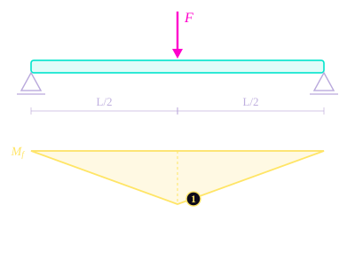
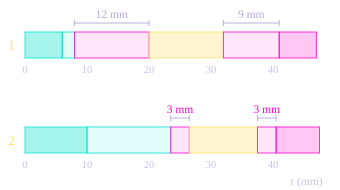

# 4\. Shaft Design

Each stage is driven by an eccentric shaft: a round shaft carrying a cam of offset $e$, on which the eccentric bearing and the disc are mounted. It is the most classical part of the reducer, a shaft in bending and torsion checked with the Von Mises criterion.

## 4.1. The Load Case

### The force on the eccentric

If the losses are neglected, the power that enters a stage is the power that leaves it. Power is the torque times speed, so:

$$
T_{\text{in}} \, \omega_{\text{in}} = T \, \omega_{\text{out}}
$$

with $T$ the output torque of the stage. The stage divides the speed by its ratio, $\omega_{\text{out}} = \omega_{\text{in}} / z_c$ , so it multiplies the torque by the same ratio. The torque that enters the stage, and that the eccentric shaft has to carry, is therefore:

$$
T_{\text{in}} = \frac{T}{z_c}
$$

For stage 2, this gives $250 / 10 = 25$ N·m. It is also the output torque of stage 1. It gives $25 / 10 = 2{,}5$ N·m, the torque of the motor.

The eccentric shaft passes this torque to the disc through the cam. The disc pushes back on the cam with a force $F$, whose lever arm around the shaft axis is the eccentricity $e$, the offset between the cam and the shaft. The equilibrium of the shaft gives:

$$
F \cdot e = \frac{T}{z_c} \qquad\Rightarrow\qquad F = \frac{T}{z_c \, e}
$$

The eccentricity is small, a few millimetres, so this force is large compared with the torque: 7 kN in stage 2. It is a mean value over one turn, in line with the simplified load model previously.

### The shaft as a beam

The shaft is modelled as a beam on two supports, its two bearings, with a span $L$ = 30 mm. The exact position of the eccentric between the bearings depends on the detailed layout of the housing, so the calculation takes the **worst case: the eccentric in the middle of the span**.

Load case of the eccentric shaft

- Shaft, on two bearings, span $L$ = 30 mm
- Force of the eccentric $F$, in the middle of the span (worst case)
- Bending moment along the shaft
- 1Maximum bending moment, under the load: $M_f = FL/4$

**Why the middle is the worst case** : For a force $F$ placed at a distance $a$ from one bearing and $b = L - a$ from the other, the statics of the beam give the reactions $R_A = F\,b/L$ and $R_B = F\,a/L$. The bending moment grows linearly from each bearing and peaks under the load:

$$
M_f = R_A \cdot a = \frac{F \, a \, (L - a)}{L}
$$

The product $a\,(L - a)$ is largest when the two lengths are equal, $a = L/2$. Any other position gives a smaller moment. With the load in the middle, each bearing carries half of the force, and the moment is:

$$
R_A = R_B = \frac{F}{2} \qquad\qquad M_f = \frac{F L}{4}
$$

The shaft also carries the input torque of the stage, between the motor side and the eccentric:

$$
M_t = \frac{T}{z_c}
$$

| | Stage 1 | Stage 2 |
| :--- | :--- | :--- |
| Stage torque $T$ | 25 N·m | 250 N·m |
| Eccentricity $e$ | 3,0 mm | 3,5 mm |
| Force on the eccentric $F$ | 833 N | 7 143 N |
| Bearing reactions $R_A = R_B$ | 417 N | 3 571 N |
| Torque $M_t$ | 2,5 N·m | 25 N·m |
| Bending moment $M_f$ | 6,3 N·m | 53,6 N·m |

### The four effects of the eccentricity

The force $F = T / (z_c e)$ and the bending moment both decrease when the eccentricity grows: the same torque is transmitted by a smaller force on a longer arm. This is one of four effects of the eccentricity met across this documentation, and they do not all go the same way:

| Effect of a larger $e$ | Consequence | Verdict |
| :--- | :--- | :--- |
| $K_1 = e \, z_p / R_p$ rises | Sharper profile, closer to undercut | Against |
| $R^*_{\text{pin}} = r_{\text{pin}}(r_{\text{pin}} + e)/e$ falls | Higher pressure on the output pins | Against |
| $F = T / (z_c e)$ falls | Eccentric bearing less loaded | In favour |
| $M_f \propto 1/e$ falls | Shaft less loaded | In favour |

Two effects push the eccentricity up and two push it down, and none of them can be traded against the others by a simple formula. This is one of the reasons the design is solved by an optimizer.

## 4.2. Combined Bending and Torsion

### The Von Mises criterion

Bending and torsion act on the same section at the same time, so they cannot be checked one after the other. The Von Mises criterion combines them into one **equivalent moment**:

$$
M_{eq} = \sqrt{M_f^2 + 0{,}75 \, M_t^2}
$$

The coefficient 0,75 comes from two facts. For a round shaft, the bending stress is $\sigma = 32 M_f / (\pi d^3)$ and the torsion stress is $\tau = 16 M_t / (\pi d^3)$, half as large for the same moment. The Von Mises criterion combines them as $\sigma_{eq} = \sqrt{\sigma^2 + 3\tau^2}$, because a material in pure shear yields at $1/\sqrt{3}$ of its tensile yield strength. Putting both together:

$$
\sigma_{eq} = \frac{32}{\pi d^3}\sqrt{M_f^2 + 3\left(\frac{M_t}{2}\right)^2} = \frac{32 \, M_{eq}}{\pi d^3}
$$

and $3 \times (1/2)^2 = 0{,}75$.

### The minimum diameter

Setting this equivalent stress equal to the admissible stress gives the minimum diameter:

$$
d_{\min} = \left(\frac{32 \, M_{eq}}{\pi \, \sigma_{\text{adm}}}\right)^{1/3} \qquad\text{with}\qquad \sigma_{\text{adm}} = \frac{R_e}{s} = \frac{1\,100}{2} = 550 \text{ MPa}
$$

$R_e$ = 1 100 MPa is the yield strength of the case-hardened steel used for the shaft, and $s = 2$ is the safety factor of the specification (Overview secttion). With the more conservative core value of the Material Selection section, $R_e$ = 662 MPa, the minimum diameters become 5,9 mm and 12,1 mm, and both shafts still pass.

!!! example "Worked example: eccentric shaft of stage 2"

    | Step | Calculation | Result |
    | :--- | :--- | :--- |
    | Force on the eccentric | $F = 250\,000 / (10 \times 3{,}5)$ | 7 143 N |
    | Bending moment | $M_f = 7\,143 \times 30 / 4$ | 53 571 N·mm |
    | Torque | $M_t = 250\,000 / 10$ | 25 000 N·mm |
    | Equivalent moment | $M_{eq} = \sqrt{53\,571^2 + 0{,}75 \times 25\,000^2}$ | 57 782 N·mm |
    | Minimum diameter | $d_{\min} = \left(32 \times 57\,782 / (\pi \times 550)\right)^{1/3}$ | 10,2 mm |

| | Stage 1 | Stage 2 |
| :--- | :--- | :--- |
| Equivalent moment $M_{eq}$ | 6,6 N·m | 57,8 N·m |
| Minimum diameter $d_{\min}$ | 5,0 mm | 10,2 mm |
| Bore of the eccentric bearing retained | 12 mm | 20 mm |
| Ratio retained / minimum | 2,4 | 2,0 |

The diameter varies as the cube root of the moment: doubling the load raises the required diameter by only 26 %. This is why both shafts pass with a wide margin even though stage 2 carries ten times more torque than stage 1.

## 4.3. From Minimum Diameter to Catalogue Bearing

The minimum diameter is not a dimension of the drawing. It is the entry point into a bearing catalogue:

1. Compute $d_{\min}$ with Von Mises.
2. Choose a catalogue bearing whose **bore** is at least $d_{\min}$ and whose **width** fits in the disc, and which survives its loads.
3. The **outer diameter** of that bearing becomes the central bore of the disc.

The third step changes the nature of the problem. In stage 2, the shaft needs 10,2 mm, but the bearing chosen around it (20 × 47 × 14 mm) is 47 mm in outer diameter. **The disc does not have to make room for the shaft, it has to make room for the bearing**, and from there the limit is space, not strength.

| | Stage 1 | Stage 2 |
| :--- | :--- | :--- |
| Eccentric bearing (bore × outer diameter × width) | 12 × 16 × 10 mm | 20 × 47 × 14 mm |
| Central bore of the disc | 16 mm | 47 mm |

## 4.4. The Radial Budget of the Disc

From the centre outwards, the disc must fit three things along the same radius: the eccentric bearing, the ring of pin bores, and the root of the cycloidal profile. Between each of them, a ligament of at least $\delta$ = 2 mm of material is needed so that the part can be machined and does not crack.

- Shaft and eccentric bearing
- Ring of pin bores
- Disc material, up to the root and the tip of the lobes

Each bar goes from the centre of the disc (r = 0) to the tip of the lobes. Top: stage 1. Bottom: stage 2. The dimensions are the ligaments between the parts.

Two conditions express this budget.

**The pin bores must clear the eccentric bearing:**

$$
\frac{D_{\text{bearing}}}{2} + \delta \;\leq\; R_{\text{pin}} - r_{\text{bore}}
$$

**The pin bores must stay inside the root of the profile:**

$$
R_{\text{pin}} + r_{\text{bore}} + \delta \;\leq\; R_p - e - r_p
$$

The right-hand side of the second condition is the root radius of the Cycloidal Profile section: the thinnest point of the disc, at the bottom of a hollow.

| | Stage 1 | Stage 2 |
| :--- | :--- | :--- |
| Ligament bearing / pin bores | 12 mm | **3 mm** |
| Ligament pin bores / profile root | 9 mm | **3 mm** |
| Margin over the 2 mm required | 10 mm / 7 mm | **1 mm / 1 mm** |

Stage 1 has plenty of room. Stage 2 is full: the larger eccentric bearing pushes the pin bores outwards, and the pin bores are stopped by the root of the profile, with only 1 mm of margin on each side. Nothing can grow in this disc without something else giving way, and the outer diameter is capped by the specification. Together with the ligament between neighbouring bores, these conditions make the disc a **closed radial budget**.

## 4.5. What Actually Governs

| Criterion | Stage 1 | Stage 2 |
| :--- | :--- | :--- |
| Shaft strength: retained / minimum diameter | 2,4 | 2,0 |
| Radial room: margin on the ligaments | 7 mm | **1 mm** |

The shafts are far from their limit in both stages: the steel never comes close to yielding in the torque path. What is close to its limit is the **room inside the disc of stage 2**, and the contact pressure on its output pins. The reducer is limited by space and by contacts, not by strength.

This also checks the load path : a shaft that came out borderline would mean that the torque was concentrated somewhere it should not be.
