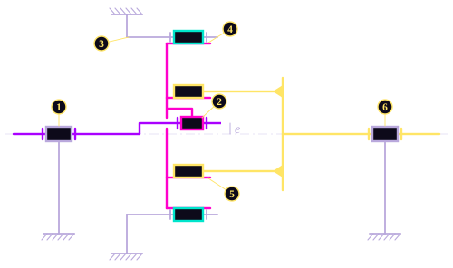
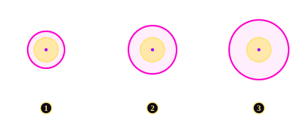

# 5\. Bearings and Isostatic Architecture

This page covers two related subjects. The first is the catalogue bearings of the reducer: which ones are used, and how they are checked. The second is a question left open in the Cycloidal Profile section: the disc is driven by ten or twelve output pins at once, which on paper over-constrains it, so how does the assembly avoid jamming?

Both subjects come down to the same idea: each part must be free to move exactly as the kinematics require, and no more.

!!! note "Bearing data"

    The catalogue bearings of this section are taken from the SKF range. Their dimensions and load ratings can be checked in the [SKF rolling bearings catalogue (PDF)](https://cdn.skfmediahub.skf.com/api/public/0901d1968094ddb3/pdf_preview_medium/0901d1968094ddb3_pdf_preview_medium.pdf){target="_blank" rel="noopener"}.

## 5.1. Three Populations

The reducer contains three distinct bearing populations. They differ in load, in speed and in what sizes them.

| | **Eccentric bearing** | **Roller bearings** | **Housing bearings** |
| :--- | :--- | :--- | :--- |
| Location | Inside each disc, on the cam | One per roller position | Between shaft and housing |
| Quantity | 1 per stage | $z_p$ per stage, stacked | 1 per shaft |
| Axis | Offset by $e$ | Fixed on the ring | Coaxial |
| Load | $F = T/(z_c e)$ (Shaft Design) | $F_{\text{roller}}$ (Mechanical Contacts) | Internal reaction |
| Sized by | ISO 281 life | Static capacity $C_0$ | Tilting moment |
| Role | Lets the disc rotate on the orbiting cam | Its outer race **is** the roller | Reacts the overturning moment |

The third row points to a mistake made at the start of the project. The first idea was to choose a mounting arrangement, **O** (back-to-back) or **X** (face-to-face), for every bearing of the reducer, including the eccentric bearing. These arrangements describe how a *pair* of angular-contact bearings share a common axis. They apply to the housing bearings, which are coaxial with the rotation axis. They do **not** apply to the eccentric bearing: it sits on the cam, offset by $e$ from the rotation axis, and it has no partner on the same axis to be arranged with. Once this was recognised, the two problems were treated separately, and the mounting of the reducer could be designed.

## 5.2. Life and Static Capacity

Each catalogue bearing is checked on two independent criteria. Passing one does not exempt it from the other.

**Fatigue (ISO 281).** The rated life at 90 % reliability is:

$$
L_{10} = \left(\frac{C}{P}\right)^{p} \qquad
L_{10,h} = \frac{L_{10} \cdot 10^6}{60 \, n}
$$

with $C$ the dynamic capacity of the bearing, $P$ its load, $n$ its speed in rpm, and an exponent set by the rolling elements: $p = 3$ for balls, $p = 10/3$ for rollers and needles. The specification requires $L_{10,h} \geq 500$ h.

Because of this exponent, the life is very sensitive to the load: a 20 % overload costs almost half of the life. The other way round, a slightly larger bearing gains a lot of life. This is why the bearing is picked from a catalogue, reference by reference, rather than sized by a formula.

**Static capacity ** : A single shock can leave a permanent dent in the raceway, whatever the fatigue life. The peak load is taken at twice the nominal load, and compared with the static capacity $C_0$ divided by a safety factor:

$$
F_{\text{peak}} = 2 \, F_{\text{nom}}
\qquad
F_{\text{peak}} \leq \frac{C_0}{s_0}, \quad s_0 = 2
$$

All the loads of the eccentric and roller bearings lie in the plane of the disc: there is no axial load ($F_a = 0$). The equivalent loads of ISO 281, $P = X F_r + Y F_a$ and $P_0 = X_0 F_r + Y_0 F_a$, then reduce to the radial load: $P = P_0 = F_r$.

**Procedure** : The table below follows the life check of the eccentric bearing of stage 1, from the data to the result.

<table class="procedure">
<thead>
<tr><th></th><th>Procedure</th><th>Example: eccentric bearing, stage 1</th></tr>
</thead>
<tbody>
<tr>
<td class="phase phase--data">Data</td>
<td>Bearing reference and its capacities, speed, loads applied to the shaft</td>
<td>Needle bearing 12 × 16 × 10 mm, $C$ = 4 950 N $n$ = 4 000 × (1 + 1/10) = 4 400 rpm, speed of the cam relative to the disc Stage torque $T$ = 25 N·m</td>
</tr>
<tr>
<td class="phase phase--need">Need</td>
<td>The life $L_{10,h}$</td>
<td>$L_{10,h} \geq 500$ h ?</td>
</tr>
<tr>
<td class="phase phase--calc">Calculation 1</td>
<td>Radial and axial loads.</td>
<td>$F_r = T / (z_c\, e) = 25\,000 / (10 \times 3) = 833$ N $F_a = 0$: all the loads lie in the plane of the disc</td>
</tr>
<tr>
<td class="phase phase--calc">Calculation 2</td>
<td><strong>Equivalent load.</strong> If $F_a / F_r \leq e$, then $P = F_r$. Otherwise $P = X F_r + Y F_a$.</td>
<td>$F_a / F_r = 0$, so $P = F_r = 833$ N</td>
</tr>
<tr>
<td class="phase phase--calc">Calculation 3</td>
<td><strong>Life in millions of revolutions.</strong> $L_{10} = (C/P)^p$, with $p = 3$ for balls and $p = 10/3$ for needles and rollers.</td>
<td>$L_{10} = (4\,950 / 833)^{10/3} = 380$ million revolutions</td>
</tr>
<tr>
<td class="phase phase--calc">Calculation 4</td>
<td><strong>Life in hours.</strong> $L_{10,h} = L_{10} \cdot 10^6 / (60\, n)$</td>
<td>$L_{10,h} = 380 \times 10^6 / (60 \times 4\,400)$</td>
</tr>
<tr>
<td class="phase phase--result">Result</td>
<td>Compare with the specification</td>
<td>$L_{10,h}$ = 1 438 h ≥ 500 h</td>
</tr>
</tbody>
</table>

The two checks cover different risks. Fatigue governs the bearings that turn fast under a steady load. The static check governs the bearings exposed to shocks, whatever their speed. A robot joint sees both: continuous motion cycles, and the occasional collision.

## 5.3. The Eccentric Bearing

The eccentric bearing sits between the cam and the disc. It lets the disc turn slowly on its own centre while that centre orbits around the main axis at the input speed of the stage.

Its load is the force on the eccentric, $F = T / (z_c e)$. It is the largest single force in each stage, and it decreases when the eccentricity grows.

The bearing is chosen from a catalogue under two conditions:

$$
d_{\text{bore}} \geq d_{\min} \quad \text{and}
\qquad
b_{\text{bearing}} \leq b_{\text{disc}}
$$

Needle and cylindrical roller bearings are both considered. At this size, they carry much more load per millimetre of width than ball bearings, and width is limited by the 40 mm axial budget.

| | Stage 1 | Stage 2 |
| :--- | :--- | :--- |
| Bearing (bore × outer diameter × width) | 12 × 16 × 10 mm | 20 × 47 × 14 mm |
| Dynamic capacity $C$ | 4 950 N | 28 500 N |
| Load $F$ | 833 N | 7 143 N |
| Speed $n$ (cam relative to the disc) | 4 400 rpm | 440 rpm |
| Life $L_{10,h}$ | 1 438 h | 3 816 h |

Both bearings meet the 500 h of the specification. The unbalance of the disc, which adds a rotating force on the eccentric bearing of stage 1, is not included here: its effect on the life is computed in the Rotordynamics section.

The choice of this bearing involves a trade-off. A larger bearing lasts longer, but its outer diameter is also larger, and that outer diameter is the central bore of the disc. Every millimetre gained on the bearing is a millimetre taken from the pin bores and the profile. This is why the eccentric bearing is chosen inside the loop, where the radial budget of the disc is checked at the same time.

## 5.4. The Roller Bearings

The rollers are catalogue ball bearings (61903), whose rolls directly on the cycloidal profile. They are therefore both a **bearing**, checked with ISO 281, and a **contact body**, already checked with Hertz's theroy.

Their life is not the issue. Their inner ring is fixed on its pin and their outer ring turns slowly, so they make few revolutions and their life is very long. What can damage them is a shock that dents the race, so the static check governs.

Stacking two bearings on one pin in stage 2 has a second benefit: it doubles both capacities.

$$
C_{\text{eff}} = n_{\text{stack}} \, C
\qquad
C_{0,\text{eff}} = n_{\text{stack}} \, C_0
$$

| | Stage 1 | Stage 2 |
| :--- | :--- | :--- |
| Bearings stacked per pin | 1 | 2 |
| Nominal / peak load | 85 / 169 N | 847 / 1 695 N |
| Admissible peak load $C_{0,\text{eff}} / s_0$ | 924 N | 1 848 N |
| Life $L_{10,h}$ | 2 080 000 h | 160 500 h |

Stage 2 passes the static check with only 9 % of margin: the rollers of stage 2 are close to their limit, and it is the stacking that makes them pass. One design choice, stacking standard bearings instead of using a wider custom roller, lowers the Hertz pressure, extends the life and doubles the static capacity, with catalogue parts only.

## 5.5. Resolving the Hyperstaticity

In its plane, the disc has three degrees of freedom: two translations and one rotation. The eccentric sets the two translations, which make the orbit. The output pins take the rotation. But there are ten or twelve of them, each in its own bore, and each one alone would be enough to stop the rotation. On paper, the assembly is **heavily over-constrained**: with exact fits, the slightest manufacturing error would make the pins fight each other.

### Kinematic diagram

All the axes of the stage are parallel and all the loads lie in the plane of the disc, so the stage can be studied as a **planar mechanism**.

- Input shaft and eccentric
- Cycloidal disc and its bores
- Rollers (2 of the 11 shown)
- Output flange and pins (2 of the 12 shown)
- Housing

One stage in axial section. The numbers refer to the joints of the table below. The eccentricity is exaggerated.

| | Joint | Between | Type | Unknowns in the plane | Number |
| :--- | :--- | :--- | :--- | :--- | :--- |
| 1 | Input bearings | Input shaft / housing | Pivot | 2 | 1 |
| 2 | Eccentric bearing | Eccentric / disc | Pivot | 2 | 1 |
| 3 | Roller bearing | Roller / its pin, fixed to the housing | Pivot | 2 | 11 |
| 4 | Roller on profile | Roller / disc | Line contact | 1 | 11 |
| 5 | Pin in bore | Output pin / disc | Line contact | 1 | 12 |
| 6 | Output bearing | Output flange / housing | Pivot | 2 | 1 |

The two line contacts are the same as in the Hertz calculation that before: two cylinders with parallel axes, touching along a line. In the plane, each one transmits a single force, along the common normal.

### Degree of hyperstaticity

For a planar mechanism, the degree of hyperstaticity is:

$$
h = \sum n_s - 3\,(p - 1) + m
$$

with $\sum n_s$ the total number of unknown forces in the joints, $p$ the number of parts including the housing, and $m$ the number of mobilities.

| Term | Value | Detail |
| :--- | :--- | :--- |
| $\sum n_s$ | 51 | 3 pivots × 2, 11 roller pivots × 2, 11 roller contacts × 1, 12 pin contacts × 1 |
| $p$ | 15 | Housing, input shaft, disc, output flange, 11 rollers |
| $m$ | 12 | The transmission itself, and the free rotation of each of the 11 rollers on its pin |

$$
h = 51 - 3 \times 14 + 12 = 21
$$

With a single roller and a single pin, the same calculation gives $h = 0$: the stage would be isostatic. The 21 extra unknowns are the **10 additional rollers and the 11 additional pins**.

 Because the stage is hyperstatic, statics alone cannot tell how the torque is shared between the rollers, or between the pins. This is why the Hertz calculation needs a load-sharing assumption (half of the rollers and pins loaded, with the same force each). The real sharing depends on the clearances and on the manufacturing accuracy.

### The role of the clearance

$$
r_{\text{bore}} = r_{\text{pin}} + e
$$

The gap between pin and bore is not a fit tolerance. It is exactly the radius of the orbit. Each pin can follow the whole orbit inside its bore without pulling on the others. Instead of fighting, the pins take turns: about half of them are in contact at any moment, which is the load sharing assumed previously.

An error on this dimension has a direct effect:

- 1**Bore too small**: the pin cuts into the bore wall at every turn. The pins jam, the disc cannot complete its orbit, and the reducer locks.
- 2**Bore = pin + $e$**: the pin touches the bore wall at one point, all the way round. It drives the disc without restraining its orbit.
- 3**Bore too large**: a gap opens between the pin and the wall. The disc can move without driving the pin, which creates backlash, amplified by the length of the arm at the tool.

This clearance is different from the working clearance described in the cycloidal profil. Here, the bore is larger than the pin by the full eccentricity, 3 to 3,5 mm, and the pin stays in contact. Privously, the machining offsets of ±0,05 mm leave a real gap of about 0,1 mm between the rollers and the profile, so that the disc does not jam on manufacturing errors.

**The most sensitive dimension of the reducer is a clearance, not a diameter**, and its value is fixed by the kinematics, with no freedom left to the designer.

## 5.6. Guiding the Output

The output flange carries the arm. It sees a large **overturning moment**, and it must be guided isostatically: with two support points, so that the moment is reacted without over-constraining the shaft.

The usual solution is two ordinary bearings, spaced apart on the shaft. It was rejected because of the axial length: two bearings and the space between them take more than the 40 mm axial budget of the reducer core.

The alternative is a single **moment bearing**: one bearing able to react a tilting moment on its own, as in industrial robot joints. Three families were compared at the same load, within the maximum diameter and the axial budget:

| Family | Example | Verdict |
| :--- | :--- | :--- |
| Double-row angular contact | SKF 3306 A | Capable, but **too wide axially** |
| Crossed roller | SKF NRT 50 A | Very high moment capacity, but **outer diameter beyond the envelope** |
| Single-row four-point contact | **SKF QJ 2xx** | **Retained**: best capacity per millimetre of width within the envelope |

The crossed roller bearing is the usual choice for a robot joint, and it was rejected on a single criterion: it does not fit inside 155 mm. The four-point contact bearing has a lower moment capacity. This is accepted, because the loads it reacts here are the internal reactions of the reducer.

This sets the limit of the study: **the external loads of the robot are not modelled**. Only the internal reactions of the reducer are. Sizing the joint against a full load case of the robot would need the dynamic model of the arm, which is a separate project.
