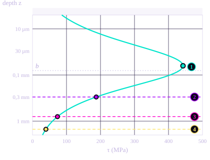
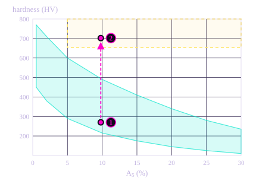
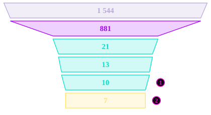

# 6\. Material Selection

The contact checks previously used an admissible pressure of 2 000 MPa for the disc. This value only holds for a hard steel, so the material has to be chosen to match it. The choice follows the Ashby method: turn the load into requirements, filter a database of materials with them, then rank what is left.

The material is chosen for the disc, because the disc carries the most loaded contact of the reducer.

!!! note "Material database"

    The selection uses an open database of 1 544 materials: [Materials dataset, Kaggle (purushottamnawale)](https://www.kaggle.com/datasets/purushottamnawale/materials){target="_blank" rel="noopener"}. For each material, it gives the tensile and yield strengths, the elongation, the hardness, the density and the heat treatment.

## 6.1. The Governing Contact

The Mechanical Contacts section showed that the most loaded contact is the **output pin against its bore in the disc of stage 2**, with a nominal pressure $P_{\text{nom}}$ = 1 042,5 MPa.

The reducer has no torque limiter, so the disc has to survive overloads by itself. A peak factor of 2 is applied to the load. The Hertz pressure varies as the square root of the load, so:

$$
P_{\text{peak}} = P_{\text{nom}} \sqrt{k_{\text{peak}}} = 1\,042{,}5 \times \sqrt{2} \approx 1\,474 \text{ MPa}
$$

All the values of this page are computed at this peak pressure, not at the nominal one used in the Mechanical Contacts section.

## 6.2. What Happens Under the Surface

### The shear stress in depth

In a rolling contact, the most stressed point is not on the surface but slightly below it. Along the axis of a line contact, the stresses are given by Johnson's solution, as a function of the depth $z$ and the contact half-width $b$:

$$
\sigma_z = -\frac{P}{\sqrt{1 + z^2/b^2}}
\qquad
\sigma_x = -P\left(\frac{1 + 2z^2/b^2}{\sqrt{1 + z^2/b^2}} - \frac{2z}{b}\right)
\qquad
\tau(z) = \frac{|\sigma_x - \sigma_z|}{2}
$$

At the peak pressure, the half-width is $b \approx$ 80 µm. The shear is maximum at $z \approx 0{,}785\,b$, with $\tau_{\max} \approx 0{,}30\,P$:

$$
\tau_{\max} \approx 443 \text{ MPa at } z \approx 63\ \mu\text{m}
$$

Shear under the contact, stage 2, peak load

- Shear stress $\tau(z)$ (depth on a log scale)
- Contact half-width $b$ = 80 µm
- 1Maximum shear: 443 MPa at 63 µm
- 2End of a nitrided case: 0,3 mm
- 3End of a case-hardened case: 0,8 mm
- 4End of an induction-hardened case: 1,5 mm

This is why rolling contacts fail by **pitting**: a crack starts below the surface, where the shear peaks, then grows back to the surface and a small flake breaks off. It also means that one number cannot describe the material. The surface, the layer below and the core each have their own requirement.

### The four requirements

**E1, surface hardness** : With the Tresca criterion and the safety factor $s$ = 2, the surface yield strength must reach $2s\,\tau_{\max}$. The database gives hardness, not yield strength, so this stress is turned into a hardness with two usual rules for steels: the tensile strength is about 3,3 times the Vickers hardness, $R_m \approx 3{,}3\,HV$, and the yield strength of a hardened steel is about 90 % of it, $R_e \approx 0{,}9\,R_m$:

$$
R_{e,\text{surface}} \geq 2 s \, \tau_{\max} = 1\,771 \text{ MPa} \quad \Rightarrow \quad HV \geq \frac{1\,771}{0{,}9 \times 3{,}3} = 596 \text{ HV}
$$

The usual rule for rolling contacts, 58 HRC, gives 653 HV. The higher value is kept: **653 HV**.

**E2, core strength under the case** : A hard case on a soft core can fail by **case crushing**: the hard layer collapses because the core below it yields. At the depth $\delta$ where the case ends, the core must carry the remaining shear:

$$
R_{e,\text{core}} \geq 2 s \, \tau(\delta)
$$

The shear drops quickly with depth, so this requirement depends on the treatment:

| Treatment | Typical case depth $\delta$ | $\tau(\delta)$ | Required core $R_e$ |
| :--- | :--- | :--- | :--- |
| Induction | 1,5 mm | 39 MPa | ≥ 158 MPa |
| Case-hardening | 0,8 mm | 73 MPa | ≥ 294 MPa |
| Nitriding | 0,3 mm | 187 MPa | ≥ 749 MPa |

Nitriding gives the hardest surface, but its case is thin and ends where the shear is still high. It is the most demanding treatment for the core.

**E3, core hardness** : ISO 6336-5 asks for at least 25 HRC in the core of a case-hardened part, that is $R_m \geq$ 850 MPa.

**E4, core ductility** : The ligaments between the pin bores, seen in the Shaft Design section, are thin and see the overloads. The core must not be brittle: $A_5 \geq$ 5 %.

## 6.3. Hard and Ductile at Once

The database is first plotted on two Ashby diagrams.

The first one, endurance limit against density with the index $M_1 = \sigma_e/\rho$, confirms that steels are the best family for this load, even per kilogram. No light alloy comes close.

The second one plots the hardness against the elongation $A_5$ of the steels. The target zone asks for both at once: at least 653 HV and at least 5 % of elongation. **No homogeneous steel reaches it.** A steel hard enough for E1 is too brittle for E4, and a steel ductile enough for E4 is too soft for E1.

Hardness against elongation (schematic)

- Homogeneous steels: harder means less ductile
- Target zone: ≥ 653 HV and $A_5$ ≥ 5 %
- 1Core of 16MnCr5: $A_5$ = 9,8 %, about 270 HV
- 2Its case-hardened surface: 702 HV

The band summarises the database diagram, it does not show the individual points. A surface treatment moves the hardness without moving the ductility of the core.

A **surface treatment** is therefore required, not optional. It separates the two requirements: a hard skin for the contact and a tough core for the ligaments. The candidate is no longer a steel alone but a pair, a steel and its treatment. In the database, 46 of the 938 steels have a surface treatment: 26 case-hardened, 10 nitrided and 10 induction-hardened.

## 6.4. Merging Equivalent Grades

The database lists the same steel under several national standards, with slightly different values. 16MnCr5, for example, appears four times: EN 16MnCr5, DIN 16MnCr5, NF 16MC5 and CSN 14220.

Left as they are, these duplicates would take several places in the ranking, and the properties of a grade would depend on the standard that happened to be read. They are grouped by grade and treatment and their properties are averaged. The 938 steels become **881 grades**.

## 6.5. The Selection Funnel

The four requirements are applied one after the other as filters.

From the database to the candidates

- Full database: 1 544 materials
- Steels, after merging the equivalent grades: 881
- F1, surface ≥ 653 HV (E1): 21
- F2, core $A_5$ ≥ 5 % (E4): 13
- F3, core $R_e \geq 2s\,\tau(\delta)$ (E2): 10
- F4, core $R_m$ ≥ 850 MPa (E3): 7 candidates
- 1Three nitrided steels rejected
- 2Three case-hardened steels rejected, including EN 16NiCr4

F1 is applied first because it removes the most candidates, from 881 to 21.

**F3 rejects three nitrided steels**: BS 722M24, BS 905M39 and NF 40CAD612, with core yield strengths of 685, 570 and 720 MPa against the 749 MPa their thin case requires. Their surface is very hard, but they would fail by case crushing.

**F4 rejects three case-hardened steels**: CSN 12010 and CSN 12020, with a core at 490 MPa, and EN 16NiCr4, at 835 MPa against 850 MPa required. For EN 16NiCr4, the miss is only 2 %, but the threshold comes from a standard and is kept as it is. As a nickel steel, this grade would also have scored low on cost.

## 6.6. Ranking the Candidates

The seven remaining steels all pass the filters, so a weighted score is used to rank them (weighted Property Method). Each criterion is normalised between 0 for the worst candidate and 1 for the best.

| Criterion | Quantity | Weight |
| :--- | :--- | ---: |
| Cost | $1/\text{cost index}$ | 25 % |
| Surface hardness | HV | 20 % |
| Core strength | $R_e$ | 20 % |
| Core ductility | $A_5$ | 20 % |
| Case depth | $\delta$ | 15 % |

The Ashby index $\sigma_e/\rho$ is not in the score. All seven candidates are steels at about 7 850 kg/m³, so it does not separate them, and the mass of the disc is already minimised by the geometry in the Design Optimization section.

Cost has the highest weight. It is not in the database, so it is estimated from the alloy family, read in the name of the grade. Nickel is the expensive element, and nitriding adds a long treatment cycle.

| Family | Examples | Cost index |
| :--- | :--- | ---: |
| Carbon | Ck15, C10 | 1,0 |
| Mn-Cr | 16MnCr5, 20MnCr5 | 1,3 |
| Cr-Mo(-V) | 30CD12, 31CrMoV9 | 1,6 (+0,3 if nitrided) |
| Ni-Cr(-Mo) | 18NCD6, 16NiCr4 | 2,0 |

This estimate is rough, but it only needs to rank families, and the order carbon, Mn-Cr, Cr-Mo, Ni-Cr is reliable.

## 6.7. Checking the Weights

The weights were chosen by the designer, so the result has to be tested against them. Each weight is moved by ±10 points in turn, the others are rescaled so that the total stays 100 %, and the winner is computed again. This gives ten variants:

| Weight changed | −10 points | +10 points |
| :--- | :--- | :--- |
| Cost | CSN 16220 | 16MnCr5 |
| Surface hardness | 16MnCr5 | CSN 16220 |
| Core strength | 16MnCr5 | 16MnCr5 |
| Core ductility | 16MnCr5 | CSN 16220 |
| Case depth | 16MnCr5 | 16MnCr5 |

**16MnCr5 wins 7 times out of 10.** CSN 16220 wins the other three, when hardness or ductility count more, or when cost counts less. This makes sense: CSN 16220 is a nickel steel, harder and tougher, but about twice as expensive. The ranking only changes for a reason that can be explained.

## 6.8. The Result

The selected material is **16MnCr5, case-hardened and quenched**, a Mn-Cr steel commonly used for gears in Europe.

| Property | Value | Requirement |
| :--- | :--- | :--- |
| Surface hardness | 702 HV | ≥ 653 HV (E1) |
| Core $R_e$ | 662 MPa | ≥ 294 MPa (E2) |
| Core $R_m$ | 891 MPa | ≥ 850 MPa (E3) |
| Core $A_5$ | 9,8 % | ≥ 5 % (E4) |
| Case depth | 0,8 mm | depth of $\tau_{\max}$: 63 µm |
| Score | 0,588 | second, CSN 16220: 0,550 |

The case depth of 0,8 mm is more than twelve times the depth of the maximum shear. The peak of $\tau$ sits well inside the hard layer, and the core only sees the small shear left at 0,8 mm.

The selection is done once, outside the optimization loop. The material is a choice in a list, while the geometry is a set of continuous variables: mixing both in the same loop would make it much heavier for no gain. The properties of 16MnCr5 are then used as constants:

| Quantity | Value | Used in |
| :--- | :--- | :--- |
| Admissible contact pressure $P_{\text{adm}}$ | 2 000 MPa | Mechanical Contacts, Hertz check |
| Young's modulus $E$, Poisson's ratio $\nu$ | 210 000 MPa, 0,30 | Mechanical Contacts, Hertz check |
| Density $\rho$ | 7 860 kg/m³ | Design Optimization, mass of the discs |
