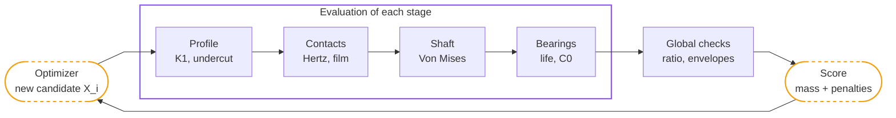
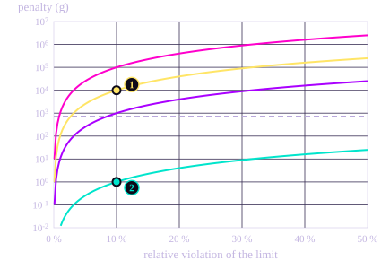
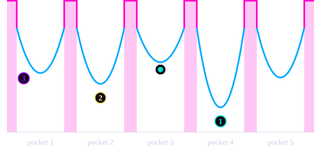

# 7\. Design Optimization

The previous sections each gave a set of rules: the shape of the profile, the contact pressures, the shafts, the bearings and the material. This section puts all of them together. The optimizer is not the last step of a sequence: it generates candidate geometries and runs every previous calculation on each of them, thousands of times.

## 7.1. Why an Optimizer

Two results from the previous sections show that the design cannot be found by hand.

The first is the **four effects of the eccentricity**, listed in the Shaft Design section: two push the eccentricity up, two push it down, and no simple formula decides between them. The second is the **closed radial budget** of the disc: the eccentric bearing, the pin bores and the root of the profile share the same radius, and nothing can grow without something else giving way.

On top of that, the ratio is fixed exactly, the two stages share the same envelopes, and the roller is a catalogue reference, not a free dimension. The first hand calculation of the project showed the problem: starting from $e$ = 5 mm, it gave $K_1$ = 0,93 and a profile with undercut, as seen in the Cycloidal Profile section.

## 7.2. One Objective, Many Constraints

The problem has **one objective**, the mass of the two discs, and everything else is a **constraint**. It is not a multi-objective problem: a lighter design that exceeds the admissible pressure is not a compromise, it is simply invalid.

**Why the mass** : The disc is the part that orbits. Its mass sets the unbalance at 4 000 rpm and the inertia the motor has to accelerate at each change of direction. Reducing it reduces both.

The loop works as follows:

## 7.3. The Design Vector

The optimizer works on fourteen variables, five of which are integers:

| # | Variable | Range | Type |
| ---: | :--- | :--- | :--- |
| 1 to 4 | Number of lobes and of output pins, per stage | 5 to 11 / 6 to 14 | integer |
| 5, 8 | Eccentricity, per stage | 1 to 6 mm | continuous |
| 6, 9 | Pitch diameter of the output pins, per stage | 15 to 70 mm | continuous |
| 7, 10 | Diameter of the output pins, per stage | 4 to 10 mm | continuous |
| 11 | Roller pitch diameter | 50 to 110 mm | continuous |
| 12 | Roller catalogue index | 0 to 33 | integer |
| 13, 14 | Disc width, per stage | 3 to 22 mm | continuous |

**Variable 12 is a catalogue position** : The roller is the outer ring of a standard ball bearing, so its diameter is not chosen freely: it is picked from a list of 34 references. One integer gives the diameter, the width and the load capacities of the roller. This makes the problem mixed, with integer and continuous variables, which rules out a purely gradient-based method. It also guarantees that the result can be built with parts that exist.

**Two variables are shared** : The roller pitch diameter and the roller reference. This is the architecture choice described in the overview: both rings are identical, and both stages have to fit in the same radial envelope.

## 7.4. Constraints as Penalties

Each constraint is added to the objective as a penalty. The penalty is the **relative** violation of the limit, squared, then multiplied by a weight:

$$
f(x) = m_{\text{total}}(x) + \sum_i w_i \left(\frac{g_i(x) - g_i^{\lim}}{g_i^{\lim}}\right)^2
$$

Dividing by the limit makes the terms comparable: a pressure in MPa, a life in hours and a clearance in millimetres could not be added otherwise. Squaring keeps the penalty smooth at the limit: a design that just touches a limit is barely penalised, and a design far beyond it is pushed back hard. The mass is counted in grams, so that it stays visible next to the penalties.

The weights are not all equal, and their order is an engineering choice:

| Weight | Constraints | Meaning |
| ---: | :--- | :--- |
| $10^7$ | Degenerate geometry, no catalogue bearing fits, eccentric bearing life | The design does not exist or does not survive |
| $10^6$ | $K_1$ bounds, undercut, ligament, Hertz, static capacity $C_0$, radial overlaps, ratio, envelopes | The design cannot be built or is unsafe |
| $10^5$ | Roller bearing life $L_{10}$ | A shorter service interval |
| $10^2$ | Film parameter $\lambda$ | Faster wear, not a failure |

Size of the penalty for each weight

- $w = 10^7$, fatal
- $w = 10^6$, unbuildable or unsafe
- $w = 10^5$, roller life
- $w = 10^2$, film parameter
- Mass of the two discs, 725 g
- 1Pressure 10 % too high: 10 000 g of penalty
- 2Film 10 % too thin: 1 g of penalty

The film parameter is five orders of magnitude softer than the rest. A pressure 10 % above its limit costs as much as fourteen reducers, while a film 10 % too thin costs one gram. The optimizer can therefore give up some lubrication margin to save mass, but it cannot touch the pressure or the undercut limit. Falling below $\lambda = 1$ means faster wear, not a broken part, and treating it as strictly as a fracture would have rejected valid designs.

Three constraints concern **both stages** : the total ratio $z_{c,1} \cdot z_{c,2} = 100$, the axial budget $b_1 + b_2 + b_{\text{flange}} \leq$ 40 mm, and the radial envelope of 155 mm.

## 7.5. Choosing the Algorithm

Three methods were tried.

**Gradient Descent with Penalties - FAILED** : It stopped on a design several times heavier than the other two methods. The reason is the difference of scale in the objective. The mass is a few hundred grams, while a violated constraint adds a penalty of up to a million. Far from the limits, the objective is almost flat and the method needs large steps to move. Close to a limit, the penalty rises so steeply that the same large step jumps over it or bounces back. No single step size works everywhere, and the method stops before reaching a light design.

**SLSQP - LOCAL MINIMUM** :  This comes from the problem itself. Each combination of the integer variables (lobe counts, pin counts, roller reference) defines its own continuous region, separated from the others by infeasible designs. A gradient method cannot jump from one region to another: it improves the region where it starts and stops there.

**Differential Evolution - SUCCESS** : It moves a whole population of candidates, so it explores several regions at the same time. It does not use the gradient, so the penalty walls do not disturb it. It also handles integer variables directly. It found the best result of the three.

Why a population is needed (schematic)

- Objective: one pocket per combination of integers
- Penalty walls: infeasible designs between the pockets
- Gradient descent: bounces between the walls and stops before the bottom
- SLSQP: reaches the bottom of its pocket quickly, but stays there
- Differential evolution: the population gathers in the best pocket
- 1Global minimum
- 2Local minimum found by SLSQP
- 3Where gradient descent stops, on a heavier design

The choice of algorithm follows from the shape of the problem, and that shape comes from a design decision: taking the roller from a catalogue.

## 7.6. Two Phases

The design is found in two phases: an automatic search by the algorithm, then a manual check where the parameters are entered by hand.

### The Automatic Search

**Differential evolution** explores the whole domain. The population has 30 candidates per variable, so 420 in total, over at most 500 generations. The algorithm is the `differential_evolution` function of the SciPy library, used with the strategy `best1bin`: each new candidate is built from the best design found so far, which makes the search converge quickly. The other settings balance this by favouring exploration, because the main risk is missing the best region, not converging slowly.

**SLSQP** then refines the result. The switch happens when differential evolution stops, for one of two reasons: either the population has converged (within a tolerance of $10^{-8}$), or the limit of 500 generations is reached. In this project, the run stopped on the generation limit. SLSQP then starts from the best candidate of the last generation. The 5 integers (seen in the previous table) are frozen at the values of that candidate. What remains is a smooth problem with nine continuous variables, and SLSQP polishes the geometry inside that region. This is exactly what it is good at, and the reason why it failed when used alone.

**The final Score** : If the refined solution scores worse than the one it started from, the original is kept. The refinement works on the penalised objective, and it can reach a point where a small gain in mass is paid by a larger violation. With this check, the refinement can only improve the result or leave it unchanged.

### The Manual Check

The algorithm works with continuous values, so its answer comes out with dimensions such as an eccentricity of 2,731 mm. These values cannot be machined or bought as they are.

The parameters are therefore entered by hand in a separate configuration: the eccentricity is rounded to a value that can be machined. This configuration is then evaluated with **exactly the same functions** as in the optimizer, so every constraint (pressures, $K_1$, undercut, ligaments, bearing lives, envelopes) is checked again on the real dimensions. If a constraint fails, the values are adjusted and the check is run again.

## 7.7. Results

There are two results: what the optimizer returned, and the design actually retained after adjusting it to real components.

| | Optimizer output | Retained design |
| :--- | :--- | :--- |
| Roller pitch diameter | 109,3 mm | **118 mm** |
| Radial envelope used | 139,3 mm | **148 mm** of 155 |
| Axial envelope used | 35 mm | **34 mm** of 40 |
| Output pins, stage 1 | 10 × Ø9,48 mm | **10 × Ø6 mm** |
| Output pins, stage 2 | 14 × Ø4 mm | **12 × Ø4 mm** |
| Hertz pressure, pin / bore, stage 2 | 946 MPa | **1 043 MPa** |
| Mass of the two discs | 435 g | **725 g** |

The 118 mm is **outside the range** given to the optimizer for this variable, 50 to 110 mm. The retained design is therefore not a point the optimizer could reach. It was chosen by hand once the search had shown which limits were active. Relaxing that bound gave the design enough room to use standard pin diameters while still meeting the strength and geometry constraints, which led to a better design in practice, even if it is heavier on paper.

**What limits the optimum.** It is not the contact pressure, even though the pin and bore contact is the most loaded one: at 1 043 MPa against 1 800 MPa admissible, it keeps a 42 % margin. The constraint that sits on its limit in the optimizer output is the **lower bound of $K_1$**:

$$
K_1 = 0{,}500 \text{ and } 0{,}501 \qquad \text{for a lower bound of } 0{,}50
$$

A smaller eccentricity frees room in the disc: the pin bores get smaller ($r_{\text{bore}} = r_{\text{pin}} + e$) and the root of the profile moves outwards ($R_p - e - r_p$). The optimizer therefore lowers the eccentricity until $K_1$ reaches its lower bound, the limit set in the Cycloidal Profile section to avoid shallow lobes and high contact forces. **The active limit is a geometric rule, not a strength limit**, which agrees with the Shaft Design section: the reducer is limited by space and by contacts, not by the strength of its parts.

## 7.8. Limits

Three simplifications are worth stating.

**The disc mass is approximated** as a plain disc, less the central bore and the pin bores, without the real lobed outline. This overestimates the mass, but in the same way for every candidate, so the ranking does not change even if the absolute value is not exact.

**Half the rollers are assumed to carry the load**, following the simplified Malhotra model described in the Mechanical Contacts section. A full model with clearance, deformation and friction, as in Qi et al., would share the load differently between the rollers and refine the pressures.

**The external loads of the robot are not modelled.** Only the internal forces of the reducer are taken into account. Checking the joint against a full robot load case would need the dynamic model of the arm.
