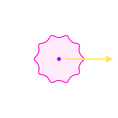
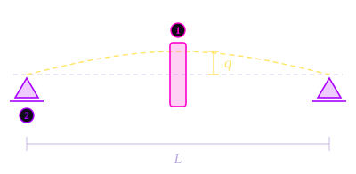
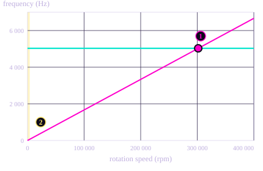
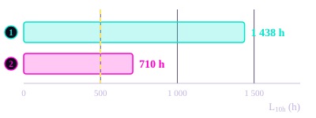

# 8\. Rotordynamics

The previous sections sized the reducer under load. This one checks it in rotation. In a cycloidal drive, the main moving part does not spin on its own axis: it **orbits** around the shaft. An orbiting mass is an unbalance, and this section measures what it costs. It is a check of the final design, made after the optimization. It does not change the geometry, it tells whether the geometry can run at 4 000 rpm without problems.

## 8.1. Why the Disc Creates an Unbalance

The eccentric drives the centre of the disc along a circle of radius $e$, at the input speed of the stage. A mass moving on a circle needs a force towards the centre of that circle, and it pushes back on its support with the opposite force, directed outwards: the **centrifugal force**. This force turns with the disc, at the same speed.

The orbiting disc

- Shaft axis
- Disc centre, on a circle of radius $e$
- Centrifugal force $m \, e \, \omega^2$, turning with the disc

The eccentricity is exaggerated to be visible.

Its magnitude is:

$$
F_{\text{unb}} = m_{\text{disc}} \; e \; \omega^2
$$

with $m_{\text{disc}}$ the mass of the disc and $\omega$ the input speed of the stage, in rad/s. This force goes through the eccentric bearing and the shaft bearings at every turn.

## 8.2. The Unbalance of the Two Stages

| | Disc mass | $e$ | Input speed | $F_{\text{unb}}$ | Transmitted force $F$ | Ratio |
| :--- | :--- | :--- | :--- | :--- | :--- | :--- |
| Stage 1 | 372,9 g | 3,0 mm | 4 000 rpm | **196 N** | 833 N | **24 %** |
| Stage 2 | 352,4 g | 3,5 mm | 400 rpm | 2,2 N | 7 143 N | 0,03 % |

The transmitted force $F = T/(z_c\,e)$ is the one found in the Shaft Design section.

The unbalance grows with the **square** of the speed. Stage 2 turns ten times slower, so its unbalance is a hundred times smaller, while the force it transmits is almost nine times larger. In stage 2, the unbalance is negligible.

## 8.3. The First Critical Speed

### Why it matters

Every shaft carrying a mass has a natural frequency of bending vibration. If the rotation speed reaches this frequency, the unbalance excites the shaft exactly at resonance and the deflection becomes very large: this is the **critical speed**. The question is whether the shaft crosses it on its way to 4 000 rpm.

### The model: Energy method and Rayleigh-Ritz

The shaft is modelled as in rotordynamics courses (Lalanne and Ferraris, *Rotordynamics Prediction in Engineering*): a flexible shaft on two rigid bearings, carrying one rigid disc. The span is $L$ = 30 mm, as in the Shaft Design section, and the disc sits in the middle. The motion is found from the energies of the system and the Lagrange equations.

The shaft model

- Shaft bending in its first mode
- Assumed shape $f(z) = \sin(\pi z / L)$, of amplitude $q$
- 1Disc at mid-span: it moves without tilting, the slope is zero
- 2Rigid bearings, zero deflection

The deflection is greatly exaggerated.

**1 - Shape of the deflection.** The shaft bends in two directions, $u$ and $v$, perpendicular to its axis $z$. Its deformed shape is approximated by a single function that is zero at both bearings:

$$
u(z, t) = f(z)\, q_1(t) \qquad v(z, t) = f(z)\, q_2(t) \qquad\text{with}\qquad f(z) = \sin\left(\frac{\pi z}{L}\right)
$$

$q_1$ and $q_2$ are the two unknowns: the deflections of the shaft at mid-span. This is the **Rayleigh-Ritz method**: a continuous shaft is reduced to a system with two degrees of freedom.

**2 - Strain energy of the shaft.** Bending stores energy in the shaft:

$$
V = \frac{1}{2} \int_0^L E I \left(\frac{d^2 f}{dz^2}\right)^2 dz \;\left(q_1^2 + q_2^2\right) = \frac{1}{2}\, k \left(q_1^2 + q_2^2\right) \qquad\Rightarrow\qquad k = \frac{\pi^4 E I}{2 L^3}
$$

with $I = \pi d^4 / 64$ the area moment of inertia of the shaft. The coefficient $\pi^4/2 \approx 48{,}7$ is very close to the 48 of the classical beam formula $48 EI/L^3$: the sine shape is almost the real deflection under a central load.

**3 - Kinetic energy.** The disc of mass $M_D$ sits where $f = 1$, and the shaft of mass $m_s$ contributes through $\int f^2 = L/2$:

$$
T = \frac{1}{2}\, m \left(\dot q_1^2 + \dot q_2^2\right) + I_{Dz}\, \Omega\, g(L/2)^2\, \dot q_1\, q_2 \qquad\text{with}\qquad m = M_D + \frac{m_s}{2}
$$

The second term is the **gyroscopic coupling**, with $I_{Dz}$ the polar inertia of the disc, $\Omega$ its spin speed and $g = df/dz$ the slope of the shaft at the disc. At mid-span the slope is zero, $g(L/2) = 0$, so **the gyroscopic coupling disappears**: the disc stays parallel to itself while the shaft bends. The shaft has a gyroscopic term of its own, but it depends on the rotary inertia of its thin section and is negligible here.

**4 - Equations of motion.** The Lagrange equations give two independent equations, one per direction:

$$
m\, \ddot q_1 + k\, q_1 = 0 \qquad\qquad m\, \ddot q_2 + k\, q_2 = 0
$$

and a natural angular frequency that does not depend on the rotation speed:

$$
\omega_0 = \sqrt{\frac{k}{m}}
$$

With a disc off-centre, the gyroscopic term would split this frequency into two branches that change with the speed (forward and backward whirl). With the disc in the middle, the two branches stay together.

### Results

| | Stage 1 | Stage 2 |
| :--- | :--- | :--- |
| Shaft diameter $d$ (bore of the eccentric bearing) | 12 mm | 20 mm |
| Second moment of area $I$ | 1 018 mm⁴ | 7 854 mm⁴ |
| Stiffness $k$ | 3,9 × 10⁸ N/m | 3,0 × 10⁹ N/m |
| Mass $m$ (disc + half of the shaft) | 386 g | 389 g |
| Natural frequency $\omega_0 / 2\pi$ | 5 030 Hz | 13 910 Hz |
| First critical speed | **≈ 302 000 rpm** | ≈ 835 000 rpm |
| Operating speed | 4 000 rpm | 400 rpm |
| Margin | **75 ×** | 2 087 × |

### The Campbell diagram

The Campbell diagram plots the natural frequencies of the rotor against its rotation speed. The unbalance excites the rotor once per turn, so it appears as a straight line, frequency = speed / 60. A critical speed is a crossing between this line and a natural frequency.

Campbell diagram, stage 1

- Natural frequency of the shaft: constant, since the gyroscopic coupling is zero
- Excitation by the unbalance, once per turn
- 1Critical speed, about 302 000 rpm
- 2Operating range, 0 to 4 000 rpm: the thin band on the left

### Why the margin is so large

The span is in the denominator with a power of three, and the diameter in the numerator with a power of four. The shaft of stage 1 is 12 mm in diameter over only 30 mm of span: it is a short, thick pin rather than a long flexible rotor, and it has almost no length to bend over.

The result does not depend on the precision of the model. The bearings and the housing are not perfectly rigid, which lowers the real stiffness. Even with supports **ten times softer** than assumed, the critical speed only drops by $\sqrt{10}$, to about 95 000 rpm, still 24 times the operating speed.

## 8.4. What the Unbalance Costs

Resonance is ruled out, but the unbalance is still there: a rotating force of 196 N that the eccentric bearing of stage 1 carries at every turn, on top of the transmitted force.

**Worst case Scenario** During one turn, the unbalance and the transmitted force are aligned at some point. Taking that moment as the design case, the load on the bearing becomes:

$$
P = F + F_{\text{unb}} = 833 + 196 = 1\,029 \text{ N}
$$

**Effect on the life time** The ISO 281 life of a needle bearing, as in the Bearings section, is:

$$
L_{10h} = \left(\frac{C}{P}\right)^{10/3} \frac{10^6}{60 \, n}
$$

with $C$ = 4 950 N the dynamic capacity of the bearing and $n$ = 4 400 rpm the speed of the cam relative to the disc, as in the Bearings section. Because of the exponent $10/3$, a 24 % increase of the load costs much more than 24 % of the life.

Eccentric bearing of stage 1

- 1Transmitted force only: 1 438 h, 2,9 times the requirement
- 2With the unbalance: 710 h, 1,4 times the requirement
- Requirement of the specification: 500 h

**The life is reduced.** The bearing still meets the 500 h of the specification, but with half the margin. The unbalance has no effect on resonance, but a real effect on the bearing. In stage 2, the life goes from 3 816 h to 3 812 h, which is no change at all.

## 8.5. Limits of the Model

The model is simple on purpose. Three simplifications are worth stating:

- **Rigid bearings.** Real bearings are flexible, which lowers the critical speed. Even a support ten times softer leaves a margin of 24.
- **Disc exactly in the middle.** The gyroscopic coupling is zero only because the disc sits at mid-span. A disc slightly off-centre would split the critical speed into two close branches, a small correction compared with a margin of 75.
- **One mode only.** With a single shape function, the Rayleigh-Ritz method gives the first mode only. The higher modes are even further from the operating range.

None of them can change a result this far from its limit. A finite element model would be the right tool for a long and flexible rotor. For a 12 mm shaft over a 30 mm span, the hand calculation is enough.