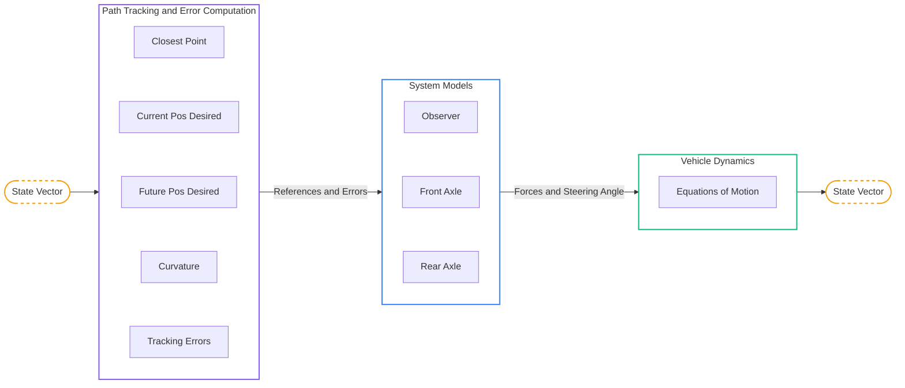

# 1\. Simulator Overview

## 1.1. Purpose and Use Cases

The primary objective of this simulator is to provide a high-fidelity testing environment for autonomous agricultural mobile robots. Unlike standard indoor robots operating on flat, high-grip surfaces, agricultural vehicles navigate highly unstructured environments. They face significant challenges such as low-adhesion soils (mud, loose dirt), varying terrain slopes, and severe non-linearities in tire-ground interactions.

Testing advanced control algorithms directly on physical heavy machinery is dangerous, time-consuming, and expensive. This simulator bridges that gap by accurately modeling the vehicle's rigid-body dynamics, actuator delays, and complex slippage phenomena.

A core feature of this project is the integration and validation of **4-Wheel Steering (4WS) control algorithms**. The independent steering of the front and rear axles provides enhanced maneuverability, reduces the turning radius at the headlands, and enables "crab steering" capabilities. This dual-axle control is critical to maintaining a zero tracking error on sloping terrains, where gravity induces significant lateral slip that a standard front-steering vehicle cannot adequately reject.

## 1.2. Global Architecture

The simulator is built around a closed-loop control architecture. It takes raw trajectory waypoints, processes the local geometry to anticipate curves, and computes tracking errors. These errors feed advanced controllers (such as Generalized Predictive Control and Exact Linearization via Backstepping) which compute the steering commands. The control effort is then subjected to actuator dynamics before being applied to the highly non-linear vehicle plant. State observers are used to estimate unmeasured variables like slip angles, closing the feedback loop.

Below is the macro-architecture of the simulator:

 

 

## 1.3. Vehicle Physical Model

To accurately simulate the vehicle's behavior, the system is modeled as a rigid body. While the simulator supports a full 4-wheel representation for tire force distribution, the kinematic and dynamic control laws are primarily derived using an **Extended Bicycle Model**. This model lumps the left and right wheels of each axle together, which is a highly effective assumption for control synthesis, provided that track width effects and load transfers are integrated into the ground contact models.

The geometric and inertial state of the vehicle is defined by the following fundamental parameters:

| Variable | Description | Unit | Code Variable |
| :---: | :--- | :---: | :--- |
| $G$ | Center of Gravity (CoG) of the vehicle | - | `X`, `Y` |
| $L_F$ | Distance from the CoG to the front axle | $m$ | `Length_Front` |
| $L_R$ | Distance from the CoG to the rear axle | $m$ | `Length_Rear` |
| $L$ | Total wheelbase of the vehicle $L = L_F + L_R$ | $m$ | `Wheelbase` |
| $E$ | Track width (distance between left and right wheels) | $m$ | `Track_Width` |
| $R_w$ | Radius of the vehicle's wheels | $m$ | `Wheel_Radius` |
| $m$ | Total mass of the vehicle | $kg$ | `Vehicle_Mass` |
| $I_z$ | Yaw moment of inertia around the vertical axis at G | $kg \cdot m^2$ | `Yaw_Inertia` |
| $C$ | Tire cornering stiffness (linear tire model) | $N \cdot rad^{-1}$ | `Cornering_Stiffness` |
| $\delta_F$ | Front mechanical steering angle | $rad$ | `Front_Steering_Angle` |
| $\delta_R$ | Rear mechanical steering angle | $rad$ | `Rear_Steering_Angle` |
| $V$ | Longitudinal velocity at the CoG | $m \cdot s^{-1}$ | `Speed` |
| $\theta$ | Global heading (yaw) angle of the vehicle frame | $rad$ | `Theta` |
| $\beta$ | Global slip angle at the CoG | $rad$ | `Vehicle_Beta` |

These geometric parameters form the basis of the coordinate transformations and kinematic relationships that will be detailed in the subsequent mathematical foundations sections.