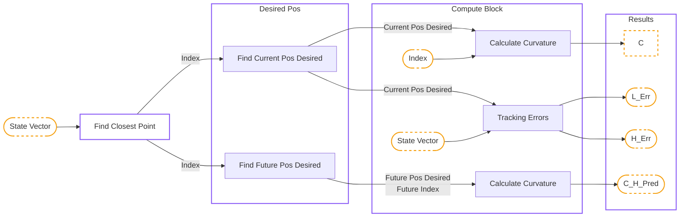
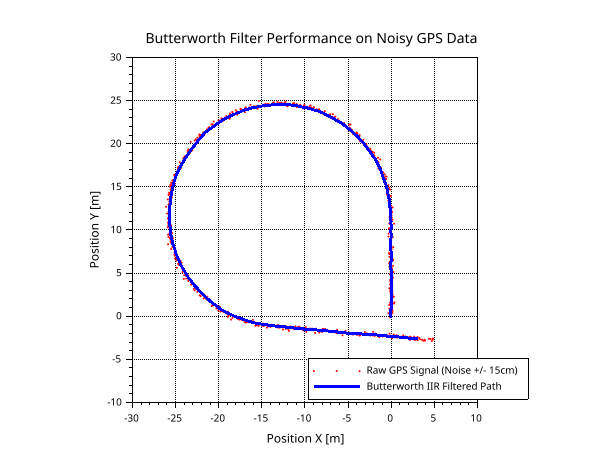

# 2\. Path Tracking and Error Computation

Before any control law can be applied, the raw reference trajectory must be processed to provide the robot with clean, actionable geometric data. Agricultural paths, often recorded via RTK GPS, contain noise and discrete jumps that can induce high-frequency oscillations in the steering actuators.

Below is the architecture of this part:

<br>



<br>

## 2.1. Trajectory Filtering

Raw discrete points are insufficient for smooth control derivatives (especially when curvature feedforward is required). To filter the sensor noise without introducing arbitrary phase shifts that would delay the robot's reaction time, a 1st-order Infinite Impulse Response (IIR) low-pass **Butterworth filter** is applied to the spatial coordinates.



The Butterworth filter is chosen for its maximally flat frequency response in the passband, ensuring no artificial ripples are added to the trajectory shape.
The filter is applied independently to the $X$ and $Y$ data sequences:

$$
X_{filtered}(k) = \text{Filter}(X_{raw}(k)) \quad \text{and} \quad Y_{filtered}(k) = \text{Filter}(Y_{raw}(k))
$$

This results in the `Smoothed_Traj` variable used throughout the simulator.

!!! scilab "Path_Filter.sce"

    ``` matlab
    function Smoothed_Traj = Path_Filter(Traj)

    X0 = Traj(1,2);
    Y0 = Traj(1,3);

    Butterworth_Filter = iir(1, 'lp', 'butt', 0.0125, [0, 0]);  

    X = Traj(:,2) - X0;
    Y = Traj(:,3) - Y0;

    Smoothed_Traj = zeros(size(Traj,1), size(Traj,2)); 
    Smoothed_Traj(:,1) = Traj(:,1);

    Smoothed_Traj(:,2) = flts(X', Butterworth_Filter)' + X0;
    Smoothed_Traj(:,3) = flts(Y', Butterworth_Filter)' + Y0;
    
    endfunction
    ```

## 2.2. Closest Point Index

To evaluate the tracking errors, the simulator must constantly find the closest trajectory point to the robot's current position $(X_{Robot}, Y_{Robot})$.
The standard Euclidean distance between the robot and a trajectory point $(X_{Traj}, Y_{Traj})$ is:

$$
d = \sqrt{(X_{Traj} - X_{Robot})^2 + (Y_{Traj} - Y_{Robot})^2 }
$$

Computing the square root for thousands of trajectory points at every simulation step is computationally expensive. Mathematically, since the square root function $f(x) = \sqrt{x}$ is strictly monotonically increasing for all $x \ge 0$, minimizing the distance $d$ is strictly equivalent to minimizing the squared distance $d^2$. Thus, the algorithm evaluates:

$$
d^2 = (X_{Traj} - X_{Robot})^2 + (Y_{Traj} - Y_{Robot})^2
$$

The index of the minimum value defines the closest discrete point on the path.

!!! scilab "Closest_Point.sce"

    ``` matlab
    function Closest_Point_Index = Find_Closest_Point_Index(Current_Position)
    
    global Smoothed_Traj ;

    X_Robot = Current_Position(1) ;
    Y_Robot = Current_Position(2) ;

    X_Traj = Smoothed_Traj(:, 2) ;
    Y_Traj = Smoothed_Traj(:, 3) ;

    Distances_Sq = (X_Traj - X_Robot).^2 + (Y_Traj - Y_Robot).^2 ;

    [Min_Val, Closest_Point_Index] = min(Distances_Sq) ;

    endfunction
    ```

## 2.3. Anticipation Logic

Due to actuator dynamics (delays in the hydraulic steering) and system inertia, a vehicle reacting only to its immediate lateral error will suffer from severe oscillations and instability. To achieve smooth tracking, the robot must anticipate upcoming curves by aiming for a future reference point on the path.

In the simulator, this anticipation logic is encapsulated within the `Future_Pos_Desired` function. The algorithm employs a "Path Walking" strategy to find exactly where the robot should look, based on a predefined `Lookahead_Distance` ($L_d$).

Starting from the robot's current closest point on the trajectory (index $i$), a virtual cursor walks forward point-by-point. At each step $k$, the Euclidean distance $d_k$ to the next discrete trajectory point is calculated:

$$
d_k = \sqrt{(X_{k+1} - X_{k})^2 + (Y_{k+1} - Y_{k})^2}
$$

These small segment lengths are continuously accumulated into a total traveled distance $S$:

$$
S = \sum_{k=i}^{j-1} d_k
$$

The `while` loop in the algorithm increments the index $k$ and accumulates $S$ until the accumulated distance reaches or exceeds the lookahead parameter:

$$
S \ge L_d
$$

Once this condition is met (or if the end of the trajectory array is reached to prevent out-of-bounds errors), the loop terminates. The final index $j$ is extracted as `Index_Future`, and its corresponding coordinates $(X_{\text{Desired}\_\text{Future}}, Y_{\text{Desired}\_\text{Future}})$ become the `Desired_Pos_Future`. This future point is critical for the feedforward curvature calculations used in the advanced control laws.

!!! scilab "Find_Future_Pos_Desired.sce"

    ``` matlab
    function [Index_Future,Desired_Pos_Future] = Future_Pos_Desired(...
     Lookahead_Distance,...
     Closest_Point_Index)
    
    global Smoothed_Traj ;

    NbPoints = size(Smoothed_Traj, 1) ;
    
    if Closest_Point_Index < 1 then
        Closest_Point_Index = 1 ;
    elseif Closest_Point_Index > NbPoints - 1 then
        Closest_Point_Index = NbPoints - 1 ;
    end

    Accumulated_Dist = 0 ;
    Current_Idx      = Closest_Point_Index ;


    while (Accumulated_Dist < Lookahead_Distance) & (Current_Idx < NbPoints - 1)
        
        P_Current = [Smoothed_Traj(Current_Idx, 2)     ; Smoothed_Traj(Current_Idx, 3)] ;
        P_Next    = [Smoothed_Traj(Current_Idx + 1, 2) ; Smoothed_Traj(Current_Idx + 1, 3)] ;
        
        Step_Dist = Compute_Distance(P_Current, P_Next) ;
        
        Accumulated_Dist = Accumulated_Dist + Step_Dist ;
        
        Current_Idx = Current_Idx + 1 ;
        
    end

    Index_Future = Current_Idx ;
    
    X_Desired_Future = Smoothed_Traj(Index_Future, 2) ;
    Y_Desired_Future = Smoothed_Traj(Index_Future, 3) ;
    
    Desired_Pos_Future = [X_Desired_Future ; Y_Desired_Future] ;

    endfunction

    ```


!!! scilab "Compute_Distance.sce"

    ``` matlab
    function d = Compute_Distance(Point_A, Point_B)

    X_Diff = Point_B(1) - Point_A(1) ;
    Y_Diff = Point_B(2) - Point_A(2) ;

    d = sqrt(X_Diff^2 + Y_Diff^2) ;

    endfunction
    ```

## 2.4. Trajectory Projection Methods

Finding the closest discrete point is not precise enough, as the robot is often located *between* two defined points. Two projection methods are implemented to find the exact, continuous orthogonal projection point $(X_{proj}, Y_{proj})$ and its tangent heading $\theta_{proj}$.

### 2.4.1. Polynomial Fitting

This method creates a local, smooth mathematical curve using 3 neighboring points: $P_{i-1}$, $P_i$ (closest point based on discrete track points), and $P_{i+1}$. We assign an arbitrary local parametric time $t \in [-1, 0, 1]$ to these points.
We model the local $X$ and $Y$ coordinates as second-order polynomials:

$$
\begin{aligned}
X(t) = A_x t^2 + B_x t + C_x \\
Y(t) = A_y t^2 + B_y t + C_y
\end{aligned}
$$

To find the coefficients for $X$, we evaluate the polynomial at the 3 local times, yielding a system of 3 linear equations:

$$
\begin{aligned}
\text{1. At } t = -1: & \quad A_x(-1)^2 + B_x(-1) + C_x &= X_{i-1} \\
\text{2. At } t = 0:  & \quad A_x(0)^2  + B_x(0)  + C_x &= X_i \\
\text{3. At } t = 1:  & \quad A_x(1)^2  + B_x(1)  + C_x &= X_{i+1}
\end{aligned}
$$

This is rewritten in matrix form using a Vandermonde matrix:

$$
\begin{aligned}
\underbrace{
\begin{bmatrix}
1 & -1 & 1 \\
0 & 0 & 1 \\
1 & 1 & 1
\end{bmatrix}
}_{\text{Vandermonde Matrix}}
\begin{bmatrix}
A_x \\
B_x \\
C_x
\end{bmatrix}
&=
\begin{bmatrix}
X_{i-1} \\
X_i \\
X_{i+1}
\end{bmatrix}
\end{aligned}
$$

The Vandermonde matrix naturally arises from polynomial modeling. Because it is built on distinct parametric time steps, its determinant is guaranteed to be non-zero, ensuring a unique and stable mathematical solution for our local curve.
<br>
By inverting the Vandermonde matrix, we obtain the coefficients $A_x, B_x,$ and $C_x$. The exact same procedure is applied to find the coefficients $A_y, B_y,$ and $C_y$ for the $Y$ coordinates.

-----

**a) Finding the Exact Orthogonal Projection**

The point $P_i$ ($t=0$) is only the *discrete* closest point. To find the true, continuous projection of the robot onto the trajectory, we must find the parameter $t_{best}$ that minimizes the squared Euclidean distance between the robot's current position $(X_{robot}, Y_{robot})$ and the polynomial curve $(X(t), Y(t))$.

The squared distance function is:

$$
D^2(t) = (X(t) - X_{robot})^2 + (Y(t) - Y_{robot})^2
$$

Instead of solving the complex derivative analytically, the algorithm generates a fine virtual curve by discretizing $t$ in the interval $[-1, 1]$ with a high-resolution step (e.g., $\Delta t = 0.02$). It evaluates $D^2(t)$ for all these generated points and extracts the $t_{best}$ that corresponds to the minimum distance.

The exact projected coordinates are therefore:

$$
\begin{aligned}
X_{proj} = A_x t_{best}^2 + B_x t_{best} + C_x \\
Y_{proj} = A_y t_{best}^2 + B_y t_{best} + C_y
\end{aligned}
$$

-----

**b) Heading Calculation**

Once $t_{best}$ is determined, the local orientation of the trajectory (the projected heading $\theta_{proj}$) is derived from the curve's tangent vector $T$ evaluated precisely at $t_{best}$.

The time-derivative of the position vector is:

$$
\begin{aligned}
T = 
\begin{bmatrix}
\dot{X}(t) \\
\dot{Y}(t)
\end{bmatrix}
&=
\begin{bmatrix}
2A_x t + B_x \\
2A_y t + B_y
\end{bmatrix}
\end{aligned}
$$

Evaluating this tangent vector at our optimal projection parameter:

$$
\begin{aligned}
\dot{X}(t_{best}) = 2A_x t_{best} + B_x \\
\dot{Y}(t_{best}) = 2A_y t_{best} + B_y
\end{aligned}
$$

Finally, the projected heading $\theta_{proj}$ is calculated using the four-quadrant arctangent. According to our simulator's specific coordinate frame (where $\theta = 0$ is aligned with the negative Y-axis, pointing downwards, and increases counter-clockwise), the relationship maps the $X$ and $Y$ velocity components as follows:

$$
\theta_{proj} = \text{atan2}(\dot{X}(t_{best}), -\dot{Y}(t_{best}))
$$

!!! scilab "Find_Future_Pos_Desired.sce"

    ``` matlab
    function Desired_Pos_Now = Current_Pos_Desired(...
    Current_Position, ...
    Closest_Point_Index, ...
    Projection_Method)

    
    global Smoothed_Traj ;

    X_Robot = Current_Position(1) ;
    Y_Robot = Current_Position(2) ;

    NbPoints      = size(Smoothed_Traj, 1) ;
    Cl_Pt_Index   = Closest_Point_Index    ;

    if Cl_Pt_Index < 2 then 
        Cl_Pt_Index = 2 ; 
    elseif Cl_Pt_Index > NbPoints - 1 then 
        Cl_Pt_Index = NbPoints - 1 ; 
    end
        
        X_Traj = Smoothed_Traj((Cl_Pt_Index-1):(Cl_Pt_Index+1), 2) ;
        Y_Traj = Smoothed_Traj((Cl_Pt_Index-1):(Cl_Pt_Index+1), 3) ;
            
        t = [-1 ; 0 ; 1] ;
        
        Vandermonde = [t.^2, t, ones(3, 1)] ;
        
        Coeffs_X = Vandermonde \ X_Traj ; // Coeffs_X = [Ax, Bx, Cx]
        Coeffs_Y = Vandermonde \ Y_Traj ; // Coeffs_Y = [Ay, By, Cy]
        
        t_calc = -1 : 0.02 : 1 ; 
        X_calc = Coeffs_X(1)*t_calc.^2 + Coeffs_X(2)*t_calc + Coeffs_X(3) ;
        Y_calc = Coeffs_Y(1)*t_calc.^2 + Coeffs_Y(2)*t_calc + Coeffs_Y(3) ;
        
        Distances = (X_calc - X_Robot).^2 + (Y_calc - Y_Robot).^2 ;
        [Min_Dist, Best_Idx] = min(Distances) ;
        
        t_best = t_calc(Best_Idx) ;
        X_Proj = X_calc(Best_Idx) ;
        Y_Proj = Y_calc(Best_Idx) ;
            
        dX_dt = 2 * Coeffs_X(1) * t_best + Coeffs_X(2) ;
        dY_dt = 2 * Coeffs_Y(1) * t_best + Coeffs_Y(2) ;
        Theta_Proj = atan(dX_dt, -dY_dt) ;
    
    Desired_Pos_Now = [X_Proj ; Y_Proj ; Theta_Proj] ;

    endfunction
    ```


### 2.4.2. Vector Geometric Projection

A faster, purely geometric approach. Let $A$ and $B$ be the two trajectory points framing the robot $R$. We define the vectors $\vec{AB} = B - A$ and $\vec{AR} = R - A$.

The exact orthogonal projection relies on the scalar product (dot product). The scalar projection ratio $\sigma$ along the segment $AB$ is calculated by projecting $\vec{AR}$ onto $\vec{AB}$:

$$
\sigma = \frac{\vec{AR} \cdot \vec{AB}}{||\vec{AB}||^2} = \frac{(X_R - X_A)(X_B - X_A) + (Y_R - Y_A)(Y_B - Y_A)}{(X_B - X_A)^2 + (Y_B - Y_A)^2}
$$

To prevent the projection from falling outside the segment (e.g., in sharp corners), $\sigma$ is saturated:

$$
\begin{aligned}
\text{If } \sigma < 0 \implies \sigma = 0 \\
\text{If } \sigma > 1 \implies \sigma = 1
\end{aligned}
$$

The exact projected coordinates and heading are:

$$
\begin{aligned}
P_{proj} = A + \sigma \vec{AB} \\
\\
\theta_{proj} = \arctan\left(\frac{X_B - X_A}{-(Y_B - Y_A)}\right)
\end{aligned}
$$

*(Note: Angle mapping matches the Scilab vertical origin frame).*

!!! scilab "Find_Future_Pos_Desired.sce"

    ``` matlab
    function Desired_Pos_Now = Current_Pos_Desired(...
    Current_Position, ...
    Closest_Point_Index, ...
    Projection_Method)

    
    global Smoothed_Traj ;

    X_Robot = Current_Position(1) ;
    Y_Robot = Current_Position(2) ;

    NbPoints      = size(Smoothed_Traj, 1) ;
    Cl_Pt_Index   = Closest_Point_Index    ;

    if Cl_Pt_Index < 2 then 
        Cl_Pt_Index = 2 ; 
    elseif Cl_Pt_Index > NbPoints - 1 then 
        Cl_Pt_Index = NbPoints - 1 ; 
    end

        P_Prev = [Smoothed_Traj(Cl_Pt_Index - 1, 2) ; Smoothed_Traj(Cl_Pt_Index - 1, 3)] ; // X-1 and Y-1
        P_Curr = [Smoothed_Traj(Cl_Pt_Index, 2)     ; Smoothed_Traj(Cl_Pt_Index, 3)]     ; // X and Y
        P_Next = [Smoothed_Traj(Cl_Pt_Index + 1, 2) ; Smoothed_Traj(Cl_Pt_Index + 1, 3)] ; // X+1 and Y+1
        P_Rob  = [X_Robot ; Y_Robot] ;
        
        Dist_Prev = norm(P_Rob - P_Prev) ;
        Dist_Next = norm(P_Rob - P_Next) ;
        
        if Dist_Next < Dist_Prev then
            A = P_Curr ;
            B = P_Next ;
        else
            A = P_Prev ;
            B = P_Curr ;
        end
        
        AB = B - A ;
        AR = P_Rob - A ;
        
        Scalar_Projection = (AR(1)*AB(1) + AR(2)*AB(2)) / (AB(1)^2 + AB(2)^2) ; // Scalar_Projection is sigma in the Theory.md
        
        Scalar_Projection = min( 1, Scalar_Projection ) ;
        Scalar_Projection = max( 0, Scalar_Projection ) ;
        
        Point_Proj = A + Scalar_Projection * AB ;
        X_Proj = Point_Proj(1) ;
        Y_Proj = Point_Proj(2) ;
        
        Theta_Proj = atan(AB(1), -AB(2))  ;

    Desired_Pos_Now = [X_Proj ; Y_Proj ; Theta_Proj] ;

    endfunction
    ```

## 2.5. Curvature Calculation

To calculate the local curvature of the track, the algorithm approximates the trajectory as a circle passing through three points in the vicinity of the robot.

Instead of taking three strictly consecutive points (which could be too close to each other and lead to numerical instability or division by zero due to discretization noise), the algorithm introduces a `Spacing` parameter (e.g., 3 points apart). We define three local points $P_1(x_1, y_1)$, $P_2(x_2, y_2)$, and $P_3(x_3, y_3)$.

A sliding window logic is implemented to ensure these points are always safely extracted, even at the very beginning or the very end of the trajectory:

  * **Start of track:** Anchored at indices $1$, $1+S$, $1+2S$.
  * **End of track:** Anchored at the last possible indices.
  * **Normal usage:** Centered around the current closest point $i$: $P_{i-S}$, $P_i$, and $P_{i+S}$.

-----

**a) Circumcenter Computation**

Three non-collinear points uniquely define a circle. The center $(X_c, Y_c)$ of this circumscribed circle is found by determining the intersection of the perpendicular bisectors of the segments $P_1P_2$ and $P_2P_3$.

By solving the geometric system, the coordinates of the circumcenter are given by the following equations:

$$
\begin{aligned}
X_c = \frac{(x_1^2 + y_1^2 - x_2^2 - y_2^2)(y_1 - y_3) - (x_1^2 + y_1^2 - x_3^2 - y_3^2)(y_1 - y_2)}{2 \big( (x_1 - x_2)(y_1 - y_3) - (x_1 - x_3)(y_1 - y_2) \big)} \\
Y_c = \frac{(x_1^2 + y_1^2 - x_2^2 - y_2^2)(x_1 - x_3) - (x_1^2 + y_1^2 - x_3^2 - y_3^2)(x_1 - x_2)}{2 \big( (y_1 - y_2)(x_1 - x_3) - (y_1 - y_3)(x_1 - x_2) \big)}
\end{aligned}
$$

*Note: In the code, a tiny constant (`1e-9`) is added to the denominator to act as a safeguard against pure division by zero when points are perfectly aligned.*

-----

**b) Signed Radius and Curvature**

If the three extracted points are perfectly aligned, the denominator approaches zero, sending the circumcenter to infinity ($X_c = \infty$ or $Y_c = \infty$). In this case, the track is a straight line, and the curvature $C$ is strictly $0$.

Otherwise, we compute the **signed radius** of curvature. The sign is crucial for control purposes (e.g., determining whether the curve turns left or right). This is achieved by projecting the vector from the robot's projected position $(X_{proj}, Y_{proj})$ to the circumcenter $(X_c, Y_c)$ onto the directional vector defined by the projected heading $\theta_{proj}$:

$$
R_{signed} = (X_c - X_{proj})\cos(\theta_{proj}) + (Y_c - Y_{proj})\sin(\theta_{proj})
$$

Finally, the curvature $C$ is simply the inverse of this signed radius:

$$
C = \frac{1}{R_{signed}}
$$

<br>

!!! scilab "Curvature.sce"

    ``` matlab
    function Curvature = Calculate_Curvature(...
    Point_Index, ... 
    Pos_Desired)
    
    global Smoothed_Traj ;
    
    NbPoints = size(Smoothed_Traj, 1) ;
    Spacing  = 3                      ;

    // Begin of the track
    if Point_Index <= Spacing then
        p1 = 1               ;
        p2 = 1 + Spacing     ;
        p3 = 1 + 2 * Spacing ;

    // End of the track    
    elseif Point_Index >= (NbPoints - Spacing) then
        p1 = NbPoints - 2 * Spacing ;
        p2 = NbPoints - Spacing     ;
        p3 = NbPoints               ;
    
    // Normal use
    else
        p1 = Point_Index - Spacing ;
        p2 = Point_Index           ;
        p3 = Point_Index + Spacing ;
    end

    x1 = Smoothed_Traj(p1, 2) ; y1 = Smoothed_Traj(p1, 3) ;
    x2 = Smoothed_Traj(p2, 2) ; y2 = Smoothed_Traj(p2, 3) ;
    x3 = Smoothed_Traj(p3, 2) ; y3 = Smoothed_Traj(p3, 3) ;

    Num_X = ((x1^2 + y1^2 - x2^2 - y2^2)*(y1 - y3) - (x1^2 + y1^2 - x3^2 - y3^2)*(y1 - y2)) ;
    Den_X = (2 * ((x1 - x2)*(y1 - y3) - (x1 - x3)*(y1 - y2))) + 1e-9;
    X_Center = Num_X / Den_X ;

    Num_Y = ((x1^2 + y1^2 - x2^2 - y2^2)*(x1 - x3) - (x1^2 + y1^2 - x3^2 - y3^2)*(x1 - x2)) ;
    Den_Y = (2 * ((y1 - y2)*(x1 - x3) - (y1 - y3)*(x1 - x2))) + 1e-9;
    Y_Center = Num_Y / Den_Y ;
    
    if abs(X_Center) == %inf | abs(Y_Center) == %inf | isnan(X_Center) then
        Curvature = 0 ;
    else
        X_Proj     = Pos_Desired(1) ;
        Y_Proj     = Pos_Desired(2) ;
        Theta_Proj = Pos_Desired(3) ;
        
        Radius_Curvature = (X_Center - X_Proj) * cos(Theta_Proj) + (Y_Center - Y_Proj) * sin(Theta_Proj) ;
        
        if Radius_Curvature == 0 then
            Curvature = 0 ;
        else
            Curvature = 1 / Radius_Curvature ;
        end
    end

    endfunction
    ```

## 2.6. Computation of Tracking Errors

Once the continuous projection point $(X_{proj}, Y_{proj})$ and the reference heading $\theta_{proj}$ are determined (see Section 2.4), the simulator must compute the relative tracking errors. This process, implemented in the `Computation_Tracking_Errors` function, represents a coordinate transformation from the **Global Cartesian Frame** to the **Local Frenet Frame**.

### 2.6.1. The Distance Vector

We define the distance vector $\vec{D}$ as the translation required to move from the projected point on the path to the robot's current position:

$$
\vec{D} = \begin{bmatrix} X_{robot} - X_{proj} \\ Y_{robot} - Y_{proj} \end{bmatrix}
$$

This vector contains the raw spatial gap, but it is not yet actionable for control because it is still expressed in global $X$ and $Y$ coordinates.

### 2.6.2. Derivation of the Lateral Error ($y$)

The lateral error $y$ is defined as the **orthogonal distance** from the robot to the path. Mathematically, this is the scalar projection of the distance vector $\vec{D}$ onto the path's unit normal vector $\vec{n}_{proj}$.

-----

**a) Defining the Reference Vectors**

Based on the simulator's specific orientation convention (where $\theta=0$ is aligned with the negative Y-axis and increases counter-clockwise), the unit tangent vector $\vec{t}_{proj}$ at the path is:

$$
\vec{t}_{proj} = \begin{bmatrix} \sin(\theta_{proj}) \\ -\cos(\theta_{proj}) \end{bmatrix}
$$

The unit normal vector $\vec{n}_{proj}$ must be perpendicular to the tangent ($\vec{t}_{proj} \cdot \vec{n}_{proj} = 0$). In this frame, the normal vector is:

$$
\vec{n}_{proj} = \begin{bmatrix} \cos(\theta_{proj}) \\ \sin(\theta_{proj}) \end{bmatrix}
$$

-----

**b) The Projection Operation**

The lateral error $y$ is the dot product of the distance vector and the normal vector:

$$
y = \vec{D} \cdot \vec{n}_{proj}
$$

$$
y = \begin{bmatrix} X_{robot} - X_{proj} \\ Y_{robot} - Y_{proj} \end{bmatrix} \cdot \begin{bmatrix} \cos(\theta_{proj}) \\ \sin(\theta_{proj}) \end{bmatrix}
$$

Expanding the dot product yields the fundamental equation used in the Scilab code:

$$
y = (X_{robot} - X_{proj})\cos(\theta_{proj}) + (Y_{robot} - Y_{proj})\sin(\theta_{proj})
$$

### 2.6.3. Derivation of the Heading Error ($\tilde{\theta}$)

The heading error represents the angular misalignment between the vehicle's chassis and the trajectory's local direction. It is defined simply as the difference between the two absolute angles:

$$
\tilde{\theta} = \theta_{robot} - \theta_{proj}
$$

### 2.6.4. Angular Fitting and Normalization

Because angles are periodic, a simple subtraction can lead to values outside the practical range $[-\pi, \pi]$. For example, if $\theta_{robot} = 170^\circ$ and $\theta_{proj} = -170^\circ$, the raw subtraction yields $340^\circ$, whereas the physical geometric error is only $-20^\circ$.

To ensure the controller always reacts to the "shortest" angular path, a wrapping logic is applied:

1.  **If $\tilde{\theta} > \pi$:** $\tilde{\theta}_{new} = \tilde{\theta} - 2\pi$
2.  **If $\tilde{\theta} < -\pi$:** $\tilde{\theta}_{new} = \tilde{\theta} + 2\pi$

### 2.6.5. Summary of the Error Vector

The final output is the tracking error vector, which serves as the entry point for all high-level control laws:

$$
\text{TrackingErrors} = \begin{bmatrix} y \\ \tilde{\theta} \end{bmatrix}^T
$$

!!! scilab "Tracking_Errors.sce"

    ``` matlab
    function Tracking_Errors = Calculate_Tracking_Errors(...
    Current_Position, ...
    Current_Pos_Desired)
    
    X_Robot     = Current_Position(1) ;
    Y_Robot     = Current_Position(2) ;
    Theta_Robot = Current_Position(3) ;
    
    X_Proj     = Current_Pos_Desired(1) ;
    Y_Proj     = Current_Pos_Desired(2) ;
    Theta_Proj = Current_Pos_Desired(3) ;

    Lat_Err = (X_Robot - X_Proj) * cos(Theta_Proj) + (Y_Robot - Y_Proj) * sin(Theta_Proj) ;
    H_Err   = Theta_Robot - Theta_Proj                                                    ;
    
    if H_Err > %pi then
        H_Err = H_Err - 2 * %pi ;
    elseif H_Err < -%pi then
        H_Err = H_Err + 2 * %pi ;
    end
  
    Tracking_Errors = [Lat_Err ; H_Err] ;

    endfunction
    ```


## 2.7. Tracking Point Offset

In standard mobile robotics, the control point is usually the center of the rear axle. However, in agriculture, the priority is the precision of the **implement** (e.g., a seeder, a plow, or a sprayer). Depending on whether the tool is mounted on the 3-point hitch or towed, the point that must strictly follow the trajectory is often located several meters behind or in front of the vehicle's reference center.

The simulator handles this via a coordinate transformation defined by two offsets:

  * $T_x$: Longitudinal offset (distance along the vehicle's main axis).
  * $T_y$: Lateral offset (side distance from the center-line).

### 2.7.1. Mathematical Transformation

Let $R(X, Y)$ be the coordinates of the rear axle center and $\theta$ be the vehicle's heading. We seek the coordinates of the Tracked Point $P_t (X_t, Y_t)$.

Based on the vehicle's local frame, the transformation uses the following trigonometric rotation (matching the simulator's vertical origin convention):

$$
\begin{aligned}
X_t = X + T_x \sin(\theta) + T_y \cos(\theta) \\
Y_t = Y - T_x \cos(\theta) + T_y \sin(\theta)
\end{aligned}
$$

### 2.7.2. Physical Impact on Control

When an offset is applied, the "Tracking Errors" ($y$ and $\tilde{\theta}$) calculated in Section 2.6 are no longer computed for the robot's center, but for the position of the tool.

  * **Positive $T_x$ (Front sensor/tool):** Increases the system's anticipation. The robot reacts to the path "ahead" of its physical center, which generally stabilizes the tracking but can lead to "cutting corners".
  * **Negative $T_x$ (Towed implement):** Adds a significant phase lag and a "trailer effect". Controlling a point behind the axle is inherently more difficult and often requires the use of the dynamic rear-steering laws detailed in Chapter 7 to maintain the tool on the line during curves.

By adjusting $T_x$ and $T_y$, the simulator can represent any configuration, from a simple autonomous tractor to a complex machine with an asymmetric side-mounted tool.