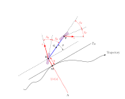
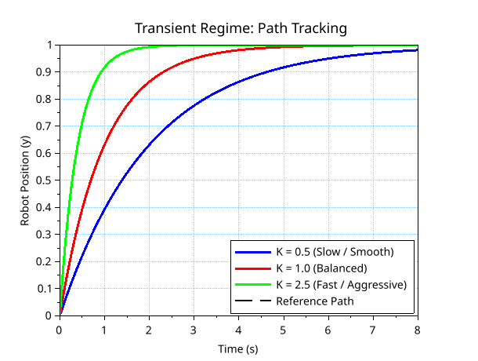

# 3\. Mathematical Foundations & Modeling

To design an effective control law for an autonomous agricultural robot, we must first establish a rigorous mathematical representation of its motion. Since our simulator operates at a constant longitudinal velocity $v$, the control objective is purely geometric: steering the vehicle to follow a reference path without needing to regulate its speed. This section establishes the fundamental kinematics of the robot and details how we model its dynamic behavior and physical constraints.

## 3.1. The Frenet-Serret Frame

Let us first consider the kinematic bicycle model (or tricycle model) in a fixed, absolute Cartesian frame $(O, \vec{I}, \vec{J})$. The robot's state is defined by the coordinates of its reference point $R$ (typically the center of the rear axle) denoted as $(X, Y)$, and its heading angle $\theta$.

Assuming a constant velocity $v$, a front steering angle $\delta_F$, and a wheelbase $L$, the absolute kinematic equations are:

$$
\begin{aligned}
\dot{X} &= v \cos(\theta) \\
\dot{Y} &= v \sin(\theta) \\
\dot{\theta} &= \frac{v \tan(\delta_F)}{L}
\end{aligned}
$$

If we attempt to control the robot using this absolute frame, the reference trajectory must be defined as a function of time: $(X_{ref}(t), Y_{ref}(t))$. This creates a critical flaw in path following: if the robot is physically delayed (e.g., due to wheel slip or actuator latency), the control law will violently try to "catch up" not only spatially, but also temporally, leading to erratic steering behaviors.

For agricultural tasks, we do not care *when* the robot reaches a specific coordinate; we only care *where* it is located relative to the planned path. To decouple the spatial geometry from time, we abandon the absolute frame and project the robot's kinematics into a moving frame attached to the trajectory itself: **the Frenet-Serret frame**.

 

### 3.1.1. Diagram Nomenclature and Geometric Construction

To fully understand the mathematical model, it is crucial to clearly define the geometric construction of the vehicle's state variables. The physical behavior of the robot is governed by both its kinematics (pure geometry of motion) and its dynamics (forces and tire slip).

Below is the exhaustive definition of the variables, points, and curves presented in the kinematic/dynamic diagram.

| Variable | Physical Representation | Geometric Construction |
| :--- | :--- | :--- |
| **$A$** | Instantaneous Center of Rotation (ICR) | The point around which the entire vehicle is momentarily rotating. It is constructed as the intersection of the lines perpendicular to the actual velocity vectors ($\vec{v}_{rear}$ and $\vec{v}_{front}$). |
| **$M$** | Path Reference Point | The exact orthogonal projection of the robot's reference point $R$ onto the reference Trajectory. |
| **$R$** | Rear Axle Center | The reference point of the vehicle, located at the geometric center of the rear axle. |
| **$F$** | Front Axle Center | The center point of the front steering axle. |
| **$G$** | Center of Gravity (CoG) | The mass center of the robot. It is located on the longitudinal segment connecting $R$ and $F$. |
| **Trajectory** | The Reference Path | The continuous, desired curve the robot is tasked to follow. |
| **$T_M$** | Path Tangent Line | The line perfectly tangent to the *Trajectory* at the projected point $M$. |
| **Dotted Parallel** | Heading Reference Line | A line passing through the robot's center $R$ that is strictly parallel to $T_M$. It is used as a baseline to visualize the angular heading error ($\tilde{\theta}$). |
| **$\vec{v}_{rear}$** | Rear Velocity Vector | The actual velocity vector of the rear axle at point $R$. Due to dynamic slip, it is not perfectly aligned with the rear wheels. |
| **$\vec{v}_{front}$** | Front Velocity Vector | The actual velocity vector of the front axle at point $F$. Due to dynamic slip, it is not perfectly aligned with the front wheels. |
| **$y$** | Lateral Tracking Error | The orthogonal distance between the robot $R$ and the trajectory $M$. Constructed as the segment $RM$ along the normal vector of the Frenet frame. |
| **$\tilde{\theta}$** | Heading Error | The angular difference between the vehicle's absolute heading $\theta$ and the reference path's local tangent. It is constructed as the angle between the vehicle's axis and the *Dotted Parallel*. |
| **$\delta_R$ / $\delta_F$** | Steering Angles | The mechanical steering angles of the rear and front wheels. Constructed as the angle between the vehicle's longitudinal axis ($RF$) and the orientation of the wheels. |
| **$\beta_R$ / $\beta_F$** | Slip Angles (Angles de dérive) | The angular difference between the mechanical orientation of the wheels and the actual velocity vectors ($\vec{v}$). These angles are purely **dynamic**: they are caused by tire deformation under lateral forces (such as centrifugal force during a turn) and are fundamental in high-speed or low-grip scenarios. |

 

**Understanding the Curvilinear Variables ($s$, $c(s)$, $1/c(s)$)**

Before detailing, we must define the intrinsic properties of the reference trajectory.

  * **$s$ (Curvilinear Abscissa):** This is the distance traveled along the reference trajectory, measured in meters from a starting point. It acts as the local "time" or progression parameter for the moving Frenet frame.
  * **$c(s)$ (Curvature):** The mathematical curvature of the path at the specific point $M$, parameterized by $s$. It represents how sharply the trajectory is bending.
  * **$1/c(s)$ (Radius of Curvature):** The inverse of the curvature gives the instantaneous radius of the circle that perfectly "kisses" the curve at point $M$. Geometrically, it is the distance from $M$ to the instantaneous center of curvature of the path.

To help visualize the dynamic relationship between the curvilinear abscissa and the instantaneous curvature, an animation of the vehicle tracking the path is provided. Below is the legend detailing the color codes and geometric elements used in the simulation.

- **Light Blue Line (Trajectory)** : The global reference path the robot must follow.
- **Thick Red Line (s)** : *Curvilinear Abscissa.* The exact distance traveled along the reference path.
- **Dark Blue Dot** : The current position of the robot's reference point (rear axle).
- **Black Circle c(s)** : *Osculating Circle.* Represents the instantaneous curvature. It shrinks during sharp turns and expands toward infinity on straight segments.
- **Thick Dashed Red Line 1/c(s)** : *Radius of Curvature.* The orthogonal distance between the robot's projected position and the center of the osculating circle.

 

### 3.1.2. Kinematic State-Space Model: Geometric Derivation of the Evolution Equations

In our relative moving frame, the complex absolute position $(X, Y, \theta)$ is reduced to two intuitive tracking errors:

1.  **The lateral error ($y$):** The orthogonal distance between the robot $R$ and the projected point $M$ on the trajectory.
2.  **The heading error ($\tilde{\theta}$):** The angular difference between the robot's absolute heading $\theta$ and the trajectory's local tangent angle $\theta_M$.

$$
\tilde{\theta} = \theta - \theta_M
$$

To control the robot, we must determine how these errors evolve over time ($\dot{y}$ and $\dot{\tilde{\theta}}$). Instead of using complex vector calculus, we can derive these equations purely through geometry based on the vehicle's diagram.

-----

**a) Lateral Error Dynamics ($\dot{y}$)**

Look at the robot's reference point $R$. The vehicle is moving with a constant longitudinal velocity $v$ in the direction of its heading $\theta$.
Since the reference path is angled at $\theta_M$, the velocity vector $v$ has an angular offset of exactly $\tilde{\theta}$ relative to the path.

We can split the velocity vector $v$ into two geometric components relative to the trajectory:

  * A velocity **parallel** to the path: $v_{\parallel} = v \cos(\tilde{\theta})$
  * A velocity **perpendicular** to the path: $v_{\perp} = v \sin(\tilde{\theta})$

Since the lateral error $y$ is strictly defined as the perpendicular distance to the path, its rate of change $\dot{y}$ is exactly equal to the perpendicular velocity component of the robot. Therefore, the lateral dynamic is simply:

$$
\dot{y} = v \sin(\tilde{\theta})
$$

-----

**b) Curvilinear Velocity ($\dot{s}$)**

To find the heading error dynamics, we first need to know how fast the projection point $M$ is moving along the reference trajectory. This speed is the derivative of the curvilinear abscissa: $\dot{s}$.

The robot is moving parallel to the path at a speed $v_{\parallel} = v \cos(\tilde{\theta})$. However, the robot is not exactly on the path; it is offset by the distance $y$.
If the path has a local curvature $c(s)$, its instantaneous radius of curvature is $R_c = \frac{1}{c(s)}$.

Because $R$ and $M$ are aligned on the same normal line originating from the center of curvature, they share the same instantaneous angular velocity $\omega$.

  * The point $M$ travels on an arc of radius $R_c$.
  * The robot $R$ travels on a parallel arc of radius $R_c - y$.

Using the standard rotational formula ($v = \omega \cdot R$), we can write the angular velocity from the robot's perspective:

$$
\omega = \frac{v_{\parallel}}{R_c - y} = \frac{v \cos(\tilde{\theta})}{\frac{1}{c(s)} - y}
$$

Now, applying this same angular velocity to the projection point $M$ to find its speed $\dot{s}$:

$$
\dot{s} = \omega \cdot R_c = \left( \frac{v \cos(\tilde{\theta})}{\frac{1}{c(s)} - y} \right) \cdot \frac{1}{c(s)}
$$

Multiplying the numerator and the denominator by $c(s)$ simplifies the fraction, giving us the exact speed of the reference point:

$$
\dot{s} = \frac{v \cos(\tilde{\theta})}{1 - y \cdot c(s)}
$$

-----

**c) Heading Error Dynamics ($\dot{\tilde{\theta}}$)**

We established that $\tilde{\theta} = \theta - \theta_M$. Taking the time derivative yields:

$$
\dot{\tilde{\theta}} = \dot{\theta} - \dot{\theta}_M
$$

From the absolute kinematic tricycle model, we know the robot's yaw rate is:

$$
\dot{\theta} = \frac{v \tan(\delta_F)}{L}
$$

For the trajectory, by the mathematical definition of curvature, the angle of the path changes with respect to the distance traveled as $\frac{d\theta_M}{ds} = c(s)$. Using the chain rule, the rate of change of the path's angle over time is:

$$
\dot{\theta}_M = \frac{d\theta_M}{ds} \cdot \frac{ds}{dt} = c(s) \cdot \dot{s}
$$

Substituting the expression for $\dot{s}$ we just found:

$$
\dot{\theta}_M = \frac{v \cos(\tilde{\theta}) c(s)}{1 - y \cdot c(s)}
$$

Finally, subtracting $\dot{\theta}_M$ from $\dot{\theta}$ gives us the complete heading error dynamic:

$$
\dot{\tilde{\theta}} = \frac{v \tan(\delta_F)}{L} - \frac{v \cos(\tilde{\theta}) c(s)}{1 - y \cdot c(s)}
$$

-----

**d) Summary of the Kinematic State-Space Model**

Through direct geometric projection, we have transformed a 3D absolute trajectory tracking problem into a 2D regulation problem. Our final continuous state-space model for path following is:

$$
\begin{bmatrix}
\dot{s} \\
\dot{y} \\
\dot{\tilde{\theta}}
\end{bmatrix}
=
\begin{bmatrix}
\frac{v \cos(\tilde{\theta})}{1 - y \cdot c(s)} \\
v \sin(\tilde{\theta}) \\
\frac{v \tan(\delta_F)}{L} - \frac{v \cos(\tilde{\theta}) c(s)}{1 - y \cdot c(s)}
\end{bmatrix}
$$

 

### 3.1.3. Extending to the Dynamic Model: Integration of Slip Angles

The purely geometric kinematic model assumes an ideal condition: the velocity vectors at the axles are perfectly aligned with the orientation of the wheels. In reality, especially in agricultural scenarios where grip is inconsistent, tire deformation and lateral forces create a discrepancy between the mechanical steering angle and the actual direction of motion. This discrepancy is the **slip angle** ($\beta$).

Furthermore, our agricultural robot model must accommodate a rear steering capability ($\delta_R$) in addition to the front steering ($\delta_F$). To control the vehicle effectively, these dynamic variables must be integrated into our state-space equations ($\dot{y}$, $\dot{s}$, and $\dot{\tilde{\theta}}$).

-----

**a) Defining the True Velocity Angles ($\alpha_R$ and $\alpha_F$)**

Let $\alpha$ be the absolute angle of the velocity vector relative to the vehicle's longitudinal axis ($RF$). This true angle is simply the sum of the mechanical steering input ($\delta$) and the dynamic slip angle ($\beta$):

$$
\begin{aligned}
\alpha_R &= \delta_R + \beta_R \\
\alpha_F &= \delta_F + \beta_F
\end{aligned}
$$

Because the rear axle velocity vector $v$ is now rotated by $\alpha_R$ relative to the vehicle body, the absolute angle of the velocity vector in the global frame is $\theta + \alpha_R$.

-----

**b) Updating Lateral Error ($\dot{y}$) and Curvilinear Velocity ($\dot{s}$)**

Recall from the pure kinematic model that tracking errors are defined relative to the path's tangent angle $\theta_M$. With the slip and rear steering incorporated, the effective angular offset between the true direction of motion at the rear axle and the reference path is no longer just $\tilde{\theta}$, but $\tilde{\theta}_{eff} = (\theta + \alpha_R) - \theta_M = \tilde{\theta} + \alpha_R$.

Substituting $\alpha_R = \delta_R + \beta_R$, we find the true orientation error of the velocity vector:

$$
\begin{aligned}
\tilde{\theta}_{eff} &= \tilde{\theta} + \beta_R + \delta_R
\end{aligned}
$$

We can now substitute this effective angle into the perpendicular and parallel velocity components defined in section 3.1.3:

1.  **For the lateral error ($\dot{y}$)**, which represents the perpendicular velocity component:

$$
\begin{aligned}
v_{\perp} &= v \sin(\tilde{\theta}_{eff}) \\
\dot{y} &= v \sin(\tilde{\theta} + \beta_R + \delta_R)
\end{aligned}
$$

2.  **For the curvilinear velocity ($\dot{s}$)**, which depends on the parallel velocity component:

$$
\begin{aligned}
v_{\parallel} &= v \cos(\tilde{\theta}_{eff}) \\
\dot{s} &= \frac{v_{\parallel}}{1 - y \cdot c(s)} \\
\dot{s} &= \frac{v \cos(\tilde{\theta} + \beta_R + \delta_R)}{1 - y \cdot c(s)}
\end{aligned}
$$

-----

**c) Deriving the True Yaw Rate ($\dot{\theta}$)**

To find the new heading error dynamic $\dot{\tilde{\theta}}$, we must first determine the absolute yaw rate $\dot{\theta}$ of the vehicle body considering both $\alpha_R$ and $\alpha_F$.

Using rigid body kinematics, we relate the velocity at the front axle $F$ to the rear axle $R$ through the rotation vector $\vec{\Omega}$ (yaw rate $\dot{\theta}$) and the wheelbase vector $\vec{RF}$ (length $L$). Projecting these velocities onto the vehicle's lateral ($y$-axis) and longitudinal ($x$-axis) frames yields:

  * Longitudinal component: $v_F \cos(\alpha_F) = v \cos(\alpha_R)$
  * Lateral component: $v_F \sin(\alpha_F) = v \sin(\alpha_R) + L\dot{\theta}$

From the longitudinal equation, we isolate $v_F = v \frac{\cos(\alpha_R)}{\cos(\alpha_F)}$. Substituting this into the lateral equation:

$$
\begin{aligned}
v \left( \frac{\cos(\alpha_R)}{\cos(\alpha_F)} \right) \sin(\alpha_F) &= v \sin(\alpha_R) + L\dot{\theta} \\
v \cos(\alpha_R) \tan(\alpha_F) &= v \sin(\alpha_R) + L\dot{\theta} \\
L\dot{\theta} &= v \cos(\alpha_R) \tan(\alpha_F) - v \sin(\alpha_R)
\end{aligned}
$$

Factoring out $v \cos(\alpha_R)$ gives us the exact analytical yaw rate:

$$
\begin{aligned}
L\dot{\theta} &= v \cos(\alpha_R) \left( \tan(\alpha_F) - \frac{\sin(\alpha_R)}{\cos(\alpha_R)} \right) \\
\dot{\theta} &= \frac{v \cos(\alpha_R)}{L} \Big( \tan(\alpha_F) - \tan(\alpha_R) \Big)
\end{aligned}
$$

To format this into the standard control formula, we use the trigonometric identity:

$$
\begin{aligned}
\tan(\alpha_F) - \tan(\alpha_R) &= \tan(\alpha_F - \alpha_R) \cdot \big( 1 + \tan(\alpha_F)\tan(\alpha_R) \big)
\end{aligned}
$$

In mobile robotics, the steering and slip angles are sufficiently small that the cross-product of their tangents is negligible ($\tan(\alpha_F)\tan(\alpha_R) \approx 0$). Applying this standard approximation, we simplify the expression:

$$
\begin{aligned}
\tan(\alpha_F) - \tan(\alpha_R) &\approx \tan(\alpha_F - \alpha_R)
\end{aligned}
$$

Substituting this back into the yaw rate equation, and replacing $\alpha_R$ and $\alpha_F$ by their respective sums:

$$
\begin{aligned}
\dot{\theta} &= \frac{v \cos(\alpha_R) \tan(\alpha_F - \alpha_R)}{L} \\
\dot{\theta} &= \frac{v \cos(\beta_R + \delta_R) \tan\big((\delta_F + \beta_F) - (\delta_R + \beta_R)\big)}{L} \\
\dot{\theta} &= \frac{v \cos(\beta_R + \delta_R) \tan(\delta_F + \beta_F - \delta_R - \beta_R)}{L}
\end{aligned}
$$

-----

**d) Final Heading Error Dynamics ($\dot{\tilde{\theta}}$)**

As defined previously, the heading error evolution is the difference between the vehicle's yaw rate and the path's angular velocity:

$$
\begin{aligned}
\dot{\tilde{\theta}} &= \dot{\theta} - \dot{\theta}_M
\end{aligned}
$$

Applying the chain rule, the trajectory's angular change over time is $\dot{\theta}_M = c(s) \cdot \dot{s}$. Using the updated $\dot{s}$ equation:

$$
\begin{aligned}
\dot{\theta}_M &= \frac{v \cdot c(s) \cos(\tilde{\theta} + \beta_R + \delta_R)}{1 - y \cdot c(s)}
\end{aligned}
$$

Finally, subtracting $\dot{\theta}_M$ from the dynamic $\dot{\theta}$ and factoring out the linear velocity $v$, we establish the complete, extended heading error dynamic equation:

$$
\begin{aligned}
\dot{\tilde{\theta}} &= v \left[ \frac{\cos(\beta_R + \delta_R) \tan(\delta_F + \beta_F - \delta_R - \beta_R)}{L} - \frac{c(s) \cos(\tilde{\theta} + \beta_R + \delta_R)}{1 - y \cdot c(s)} \right]
\end{aligned}
$$

-----

**e) Final State-Space Representation**

To synthesize the previous derivations, we define the complete state vector relative to the reference trajectory as $X = [s, y, \tilde{\theta}]^T$.

Grouping the individual dynamics yields the final continuous-time, non-linear extended kinematic model:

$$\begin{aligned}
\begin{bmatrix} 
\dot{s} \\ 
\dot{y} \\ 
\dot{\tilde{\theta}} 
\end{bmatrix} 
= 
\begin{bmatrix}
\frac{v \cos(\tilde{\theta} + \beta_R + \delta_R)}{1 - y \cdot c(s)} \\[1.5em]
v \sin(\tilde{\theta} + \beta_R + \delta_R) \\[1.5em]
\frac{v \cos(\beta_R + \delta_R) \tan(\delta_F + \beta_F - \delta_R - \beta_R)}{L} - \frac{v \cdot c(s) \cos(\tilde{\theta} + \beta_R + \delta_R)}{1 - y \cdot c(s)}
\end{bmatrix}
\end{aligned}$$

This system of differential equations dictates the exact behavior of the tracking errors and serves as the foundation for our advanced control strategies (such as Backstepping and MPC).

 

## 3.2. Numerical Integration: Euler Method for State Evolution

The continuous-time state-space model derived in the previous section describes the exact analytical rates of change ($\dot{X}$) of the vehicle. However, to simulate this physical behavior in a digital environment like Scilab, we must discretize time. The continuous system must be evaluated at discrete time steps of length $\Delta t$.

To find the state $X$ at the next time step ($t + \Delta t$), we rely on the fundamental theorem of calculus:

$$
X(t + \Delta t) = X(t) + \int_{t}^{t + \Delta t} \dot{X}(\tau) d\tau
$$

For a sufficiently small time step $\Delta t$, we can assume that the rate of change $\dot{X}$ remains constant over the interval. This assumption is formalized by truncating the Taylor series expansion at the first order:

$$
X(t + \Delta t) = X(t) + \dot{X}(t) \cdot \Delta t + \mathcal{O}(\Delta t^2)
$$

By neglecting the higher-order terms $O(\Delta t^2)$, we obtain the **Forward Euler Method**. Let $k$ denote the current discrete time step and $k+1$ the next step. Applying this numerical integration to our absolute position ($x, y$) and heading ($\theta$) yields:

$$\begin{aligned}
\begin{bmatrix} 
x_{k+1} \\[0.5em] 
y_{k+1} \\[0.5em] 
\theta_{k+1} 
\end{bmatrix} 
= 
\begin{bmatrix} 
x_{k} \\[0.5em] 
y_{k} \\[0.5em] 
\theta_{k} 
\end{bmatrix} 
+ 
\Delta t \cdot
\begin{bmatrix} 
v_k \cos(\theta_k + \alpha_{R,k}) \\[0.5em] 
v_k \sin(\theta_k + \alpha_{R,k}) \\[0.5em] 
\dot{\theta}_k
\end{bmatrix}
\end{aligned}$$

While simple, the Euler method is highly effective for mobile robotics simulation, provided that the sampling time $\Delta t$ is strictly chosen to be smaller than the fastest dynamic of the system to ensure numerical stability.

**Important Clarification: The Two Reference Frames**

Before proceeding, it is crucial to address a common source of confusion: why do we apply Euler integration to the simple sine/cosine equations above, rather than to the complex extended kinematic equations ($\dot{y}, \dot{\tilde{\theta}}$) derived in section 3.1?

The answer lies in understanding that the simulation operates across two distinct mathematical worlds:

1.  **The Global Cartesian Frame (Absolute Physics):** The simple equations above compute the vehicle's absolute coordinates ($X, Y$) on the map. The simulator's physics engine uses Euler integration on these equations because they dictate the actual, physical translation of the robot in the 2D world.
2.  **The Relative Frenet Frame (Control Logic):** The complex state-space equations derived earlier operate purely in a moving frame relative to the trajectory. In those equations, the variable $y$ is **not** a map coordinate; it is the **lateral tracking error** (the distance to the path). Those complex equations are not used to physically move the robot in the simulator. Instead, they serve as the theoretical foundation for the control algorithm to understand how errors evolve.

**The Simulation Loop:** 

 

At every time step, these two frames collaborate. First, the physics engine physically moves the tractor to a new absolute position ($X, Y$) using Euler integration. Next, the simulator projects this new coordinate onto the reference path to measure the new relative errors ($y$ and $\tilde{\theta}$). Finally, the control algorithm uses the complex relative kinematics to compute the optimal steering command to correct these errors in the next step.

## 3.3. Trigonometric Limits & Angular Wrapping

When implementing the mathematical model in software, we encounter two major numerical vulnerabilities inherent to trigonometry: **tangent singularities and angular unboundedness**.

### 3.3.1 Tangent Singularities

Recall the yaw rate equation, which features the term $\tan(\delta_F + \beta_F - \delta_R - \beta_R)$. The tangent function approaches infinity as its argument approaches $\pm \frac{\pi}{2}$ rad (90°).

$$
\lim_{x \to \frac{\pi}{2}} \tan(x) = +\infty
$$

If the difference between the front and rear effective angles exceeds this limit, the computed yaw rate would become `NaN` (Not a Number), immediately crashing the simulation. To prevent this, strict physical saturation limits are imposed on the steering inputs before computing the kinematics:

$$
-\delta_{max} \le \delta \le \delta_{max} \quad \text{where} \quad \delta_{max} \ll \frac{\pi}{2}
$$

### 3.3.2 Angular Wrapping (Modulo Operation)

As the robot operates, accumulating continuous left turns causes the absolute heading $\theta$ to grow indefinitely ($2\pi, 4\pi, 6\pi...$). If the robot is oriented at $2\pi$ radians and the reference trajectory is at $0$ radians, the physical heading error is zero, but the mathematical difference yields $\tilde{\theta} = 2\pi$. A control law receiving a $2\pi$ error would violently and unnecessarily steer the robot.

To ensure tracking errors correctly reflect the shortest geometric distance, we must "wrap" all angle differences back to the principal interval $[-\pi, \pi]$.
We define the raw error as $e = \theta - \theta_M$. To normalize it, we shift the domain, apply a continuous modulo of $2\pi$, and shift it back:

$$
\tilde{\theta} = \left( (e + \pi) \pmod{2\pi} \right) - \pi
$$

Alternatively, in software, this is robustly implemented using the two-argument arctangent function, which strictly maps to $[-\pi, \pi]$ based on the unit circle components:

$$
\tilde{\theta} = \text{atan2}(\sin(\theta - \theta_M), \cos(\theta - \theta_M))
$$

## 3.4. Actuator Dynamics and Delay: State-Space Representation

Up to this point, we assumed the steering angles ($\delta_F, \delta_R$) perfectly and instantly matched the controller's commands ($\delta_{F, cmd}, \delta_{R, cmd}$). In reality, physical motors possess inertia, friction, and inherent reaction delays.

To create a realistic agricultural simulator, the steering mechanisms are modeled as first-order low-pass systems. The true mechanical angle $\delta$ tries to reach the commanded angle $\delta_{cmd}$ at a rate determined by a time constant $\tau$. The differential equation governing this delay is:

$$
\tau \cdot \dot{\delta} + \delta = \delta_{cmd}
$$

Rearranging to isolate the state derivative (the mechanical velocity of the steering motor):

$$
\begin{aligned}
\dot{\delta} &= \frac{1}{\tau} (\delta_{cmd} - \delta) \\
\dot{\delta} &= -\frac{1}{\tau} \delta + \frac{1}{\tau} \delta_{cmd}
\end{aligned}
$$

We can express this coupled dynamic for both the front and rear axles using a standard linear state-space representation. Let $X_{act} = [\delta_F, \delta_R]^T$ be the true state of the actuators, and $U_{act} = [\delta_{F,cmd}, \delta_{R,cmd}]^T$ be the input command vector from the CPU:

$$
\begin{aligned}
\begin{bmatrix} 
\dot{\delta}_F \\[1.5em] 
\dot{\delta}_R 
\end{bmatrix} 
&= 
\begin{bmatrix} 
-\frac{1}{\tau_F} & 0 \\[1.5em] 
0 & -\frac{1}{\tau_R} 
\end{bmatrix} 
\begin{bmatrix} 
\delta_F \\[1.5em] 
\delta_R 
\end{bmatrix} 
+ 
\begin{bmatrix} 
\frac{1}{\tau_F} & 0 \\[1.5em] 
0 & \frac{1}{\tau_R} 
\end{bmatrix} 
\begin{bmatrix} 
\delta_{F, cmd} \\[1.5em] 
\delta_{R, cmd} 
\end{bmatrix}
\end{aligned}
$$

This matrix formulation introduces an unavoidable physical lag into the simulation. This lag justifies the future need for advanced strategies like Model Predictive Control (MPC), which can anticipate the delayed response of the hardware.

## 3.5. Imposing a Dynamic Behavior: The First-Order Error Convergence

The ultimate goal of our control algorithms (like Backstepping) is to compute a steering angle that drives the tracking errors ($y$ and $\tilde{\theta}$) to zero. But *how* they go to zero is equally important. If the correction is too aggressive, the robot will oscillate and lose grip; if it is too slow, it will miss the turn.

To guarantee a stable and smooth return to the trajectory, we force the error to obey a specific, chosen differential equation. The most common choice is a first-order linear decay, defined by a proportional gain $K > 0$:

$$
\dot{e} = -K \cdot e
$$

To understand why this specific structure is mathematically desirable, we solve this differential equation by separating the variables:

$$
\begin{aligned}
\frac{de}{dt} &= -K \cdot e \\
\frac{1}{e} de &= -K dt
\end{aligned}
$$

We integrate both sides from the initial time $t=0$ to a given time $t$, with the initial error being $e_0$:

$$
\begin{aligned}
\int_{e_0}^{e(t)} \frac{1}{e} de &= \int_{0}^{t} -K dt \\
\Big[ \ln|e| \Big]_{e_0}^{e(t)} &= \Big[ -K \cdot \tau \Big]_{0}^{t} \\
\ln(e(t)) - \ln(e_0) &= -K \cdot t \\
\ln\left( \frac{e(t)}{e_0} \right) &= -K \cdot t
\end{aligned}
$$

Applying the exponential function to both sides to solve for the error at time $t$:

$$
\begin{aligned}
\frac{e(t)}{e_0} &= \exp(-K \cdot t) \\
e(t) &= e_0 \cdot e^{-Kt}
\end{aligned}
$$

This fundamental mathematical result reveals the **transient regime**. Because $K$ is positive, $e^{-Kt}$ is an exponential decay.

  * As $t \to \infty$, the tracking error strictly converges to exactly $0$ without any oscillations.
  * The parameter $K$ acts as a tuning knob: a higher $K$ causes a faster, stiffer convergence, while a lower $K$ yields a slower, smoother approach.

By matching the complex kinematic derivatives derived in section 3.1 ($\dot{y}$, $\dot{\tilde{\theta}}$) to this ideal imposed dynamic ($\dot{e} = -K e$), we can mathematically isolate and extract the exact steering command needed to achieve perfect trajectory tracking.