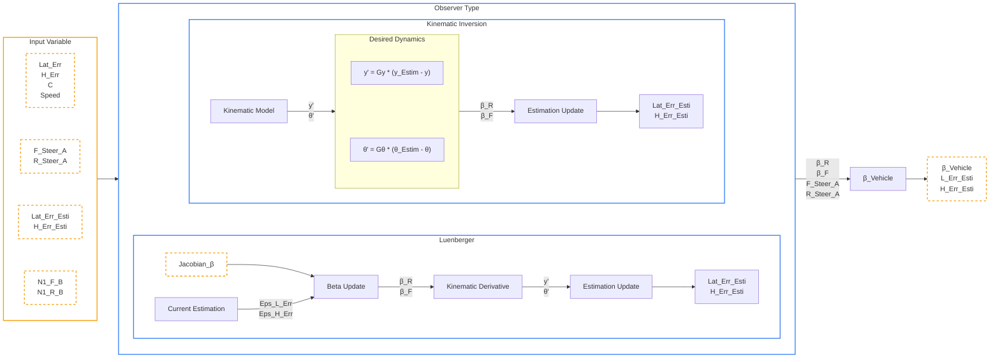

# 5\. State Observers

In agricultural robotics, relying solely on GPS (RTK) sensors presents a fundamental control problem. A high-precision GPS can provide the absolute position $(X, Y)$ and the heading $(\theta)$, allowing us to calculate the tracking errors $y$ and $\tilde{\theta}$. However, advanced control algorithms require knowledge of the internal dynamic states, specifically the tire slip angles ($\beta_F$ and $\beta_R$).

Because slip angles are purely dynamic phenomena representing the deformation of the tire and the sliding of the vehicle, they cannot be measured directly without prohibitively expensive optical ground-speed sensors. To bridge this gap, we implement **State Observers**. An observer uses the mathematical model of the vehicle alongside the available sensor data to estimate these hidden variables in real-time.

Below is the architecture of the observer:

<br>



<br>

## 5.1. Observer 1: Kinematic Inversion

The first approach is a deterministic observer based on Kinematic Inversion. It works by forcing the estimated tracking errors to converge towards the actual measured errors according to a chosen, stable dynamic.

Before deriving the observer, let us recall the continuous extended kinematic model established in Section 3:

$$
\begin{aligned}
\dot{y} &= v \sin(\tilde{\theta} + \beta_R + \delta_R) \\
\dot{\tilde{\theta}} &= \frac{v \cos(\beta_R + \delta_R)}{L} \Big( \tan(\delta_F + \beta_F) - \tan(\delta_R + \beta_R) \Big) - \frac{v \cdot c(s) \cos(\tilde{\theta} + \beta_R + \delta_R)}{1 - y \cdot c(s)}
\end{aligned}
$$

We define the estimated states as $\hat{y}$ and $\hat{\tilde{\theta}}$. The estimation errors (the difference between the observer's belief and the actual GPS measurements) are defined as:

$$
\begin{aligned}
\epsilon_y &= \hat{y} - y \\
\epsilon_{\theta} &= \hat{\tilde{\theta}} - \tilde{\theta}
\end{aligned}
$$

To ensure the observer converges, we impose a desired first-order linear dynamic using strictly negative tuning gains $G_y$ and $G_{\theta}$ (as established in Section 3.5 regarding first-order error convergence):

$$
\begin{aligned}
\dot{\hat{y}} &= G_y \cdot \epsilon_y \\
\dot{\hat{\tilde{\theta}}} &= G_{\theta} \cdot \epsilon_{\theta}
\end{aligned}
$$

### 5.1.1 Estimating Rear Slip

We equate the theoretical lateral kinematic equation (evaluated with estimated states) to our imposed dynamic:

$$
v \sin(\hat{\tilde{\theta}} + \beta_R + \delta_R) = G_y \cdot \epsilon_y
$$

We isolate the sine term by dividing by the velocity $v$:

$$
\sin(\hat{\tilde{\theta}} + \beta_R + \delta_R) = \frac{G_y \cdot \epsilon_y}{v}
$$

Applying the inverse sine function ($\arcsin$) and isolating $\beta_R$ yields the exact rear slip angle:

$$
\beta_R = \arcsin \left( \frac{G_y \cdot \epsilon_y}{v} \right) - \big( \hat{\tilde{\theta}} + \delta_R \big)
$$

!!! scilab "Observer.sce"

    ``` matlab
    Gy = -30 ;
    Gt = -10 ;
    
    // ---------- Low Speed
    if Speed < 0.5 then
        Lat_Err_Esti = Lat_Err ;
        H_Err_Esti   = H_Err   ;
        Front_Beta   = 0       ;
        Rear_Beta    = 0       ;
    
    // ---------- Normal Speed
    else       
        Eps_Lat             = Lat_Err_Esti - Lat_Err ;
        Eps_H               = H_Err_Esti - H_Err     ;
        Path_Scale_Factor   = 1 - C * Lat_Err_Esti   ;
        PSF                 = Path_Scale_Factor      ;

        // ---------- Rear Beta from Kinematic Model
        Valeur_Asin = (Gy * Eps_Lat ) / Speed ; // Desired dynamic from Gy
        Valeur_Asin = min( 1 ,Valeur_Asin)    ; // Safty because Asin ∈ [1,-1]
        Valeur_Asin = max(-1 ,Valeur_Asin)    ;

        Rear_Beta = asin(Valeur_Asin) - (H_Err_Esti + R_Steer_A) ;

        // Angle wrapping between [-π,π]
        Rear_Beta = atan( sin(Rear_Beta), cos(Rear_Beta) )       ;
    end
    ```

### 5.1.2 Estimating Front Slip

Similarly, we equate the theoretical heading kinematic equation to our imposed angular dynamic:

$$
\frac{v \cos(\beta_R + \delta_R)}{L} \Big( \tan(\delta_F + \beta_F) - \tan(\delta_R + \beta_R) \Big) - \frac{v \cdot c(s) \cos(\hat{\tilde{\theta}} + \beta_R + \delta_R)}{1 - \hat{y} \cdot c(s)} = G_{\theta} \cdot \epsilon_{\theta}
$$

To simplify the notation, let us define two intermediary angles exactly as they are coded in the simulator:

$$
\Theta_2 = \hat{\tilde{\theta}} + \beta_R + \delta_R \\
\Theta_3 = \beta_R + \delta_R \\
PSF = 1 - \hat{y} \cdot c(s) \text{ (Path Scale Factor)}
$$

Substituting these into the equation:

$$
\frac{v \cos(\Theta_3)}{L} \Big( \tan(\delta_F + \beta_F) - \tan(\Theta_3) \Big) - \frac{v \cdot c(s) \cos(\Theta_2)}{PSF} = G_{\theta} \cdot \epsilon_{\theta}
$$

We isolate the tangent difference by moving the curvature term to the right side and multiplying by the inverse of the leading fraction:

$$
\tan(\delta_F + \beta_F) - \tan(\Theta_3) = \frac{L}{v \cos(\Theta_3)} \left( G_{\theta} \cdot \epsilon_{\theta} + \frac{v \cdot c(s) \cos(\Theta_2)}{PSF} \right)
$$

Moving $\tan(\Theta_3)$ to the right side:

$$
\tan(\delta_F + \beta_F) = \frac{L}{v \cos(\Theta_3)} \left( G_{\theta} \cdot \epsilon_{\theta} + \frac{v \cdot c(s) \cos(\Theta_2)}{PSF} \right) + \tan(\Theta_3)
$$

Finally, applying the inverse tangent ($\arctan$) and subtracting $\delta_F$ provides the estimated front slip angle:

$$
\beta_F = \arctan \left[ \frac{L}{v \cos(\Theta_3)} \left( G_{\theta} \cdot \epsilon_{\theta} + \frac{v \cdot c(s) \cos(\Theta_2)}{PSF} \right) + \tan(\Theta_3) \right] - \delta_F
$$

!!! scilab "Observer.sce"

    ``` matlab
    Gy = -30 ;
    Gt = -10 ;
    
    // ---------- Low Speed
    if Speed < 0.5 then
        Lat_Err_Esti = Lat_Err ;
        H_Err_Esti   = H_Err   ;
        Front_Beta   = 0       ;
        Rear_Beta    = 0       ;
    
    // ---------- Normal Speed
    else       
        Eps_Lat             = Lat_Err_Esti - Lat_Err ;
        Eps_H               = H_Err_Esti - H_Err     ;
        Path_Scale_Factor   = 1 - C * Lat_Err_Esti   ;
        PSF                 = Path_Scale_Factor      ;

        // ---------- Front Beta from Kinematic Model
        Theta_2 = H_Err_Esti + Rear_Beta + R_Steer_A ;
        Theta_3 = Rear_Beta + R_Steer_A              ;

        Front_Beta = atan( (Wheelbase / (Speed * cos(Theta_3) ) ) ...                           
                        * (Gt * Eps_H + Speed * C * cos(Theta_2) / PSF) + tan(Theta_3) ) ...
                        - F_Steer_A ; 

        // Angle wrapping between [-π,π]                                 
        Front_Beta = atan( sin(Front_Beta), cos(Front_Beta) ) ;   
    end
    ```

## 5.2. Observer 2: Extended Adaptive Luenberger Observer

While Kinematic Inversion is fast, it is highly sensitive to sensor noise. For a more robust estimation, the simulator implements an Extended Luenberger Observer. This observer runs a parallel simulation of the robot's kinematics and continuously corrects its internal states ($\hat{y}, \hat{\tilde{\theta}}$) and parameters ($\beta_F, \beta_R$) using feedback matrices.

### 5.2.1. State Error & Formulation

Let $\tilde{X} = [\epsilon_y, \epsilon_{\theta}]^T$ be the bounded state estimation error.
We define two feedback gain matrices: $K_1$ corrects the kinematic states, and $K_2$ drives the adaptation of the unmeasured parameters (slip angles).

The state update equation is formulated as:

$$
\begin{aligned}
\begin{bmatrix} \dot{\hat{y}} \\ \dot{\hat{\tilde{\theta}}} \end{bmatrix}
= f_{kinematics}(\hat{y}, \hat{\tilde{\theta}}, \beta_F, \beta_R) + K_1 \cdot \tilde{X}
\end{aligned}
$$

### 5.2.2. Sensitivity Jacobian Matrix

To correctly update the slip angles, the observer needs to know how a tiny change in $\beta$ affects the overall motion of the robot. This sensitivity is mathematically represented by the Jacobian Matrix of the kinematic model with respect to the parameters $\beta = [\beta_F, \beta_R]^T$.

$$
\begin{aligned}
J_{\beta} = 
\begin{bmatrix} 
\dfrac{\partial \dot{y}}{\partial \beta_F} & \dfrac{\partial \dot{y}}{\partial \beta_R} \\
\dfrac{\partial \dot{\tilde{\theta}}}{\partial \beta_F} & \dfrac{\partial \dot{\tilde{\theta}}}{\partial \beta_R} 
\end{bmatrix}
\end{aligned}
$$

We derive these partial derivatives directly from the base kinematic equations.
*(Note: To save computational resources in the Jacobian, the simulator approximates the rear steering $\delta_R \approx 0$ inside the partial derivatives, a valid assumption for slight corrective steering).*

**Row 1: Derivatives of Lateral Velocity ($\dot{y} = v \sin(\hat{\tilde{\theta}} + \beta_R)$)**

$$
\begin{aligned}
J_{1,1} &= \frac{\partial \dot{y}}{\partial \beta_F} = 0 \\
J_{1,2} &= \frac{\partial \dot{y}}{\partial \beta_R} = v \cos(\hat{\tilde{\theta}} + \beta_R)
\end{aligned}
$$

**Row 2: Derivatives of Yaw Rate ($\dot{\tilde{\theta}}$)**

Recall the simplified yaw rate equation:

$$
\dot{\tilde{\theta}} = \frac{v \cos(\beta_R)}{L} \Big( \tan(\delta_F + \beta_F) - \tan(\beta_R) \Big) - \frac{v \cdot c(s) \cos(\hat{\tilde{\theta}} + \beta_R)}{PSF}
$$

The derivative with respect to $\beta_F$ relies on the rule $\frac{d}{dx}\tan(x) = 1 + \tan^2(x)$:

$$
J_{2,1} = \frac{\partial \dot{\tilde{\theta}}}{\partial \beta_F} = \frac{v \cos(\beta_R)}{L} \Big( 1 + \tan^2(\delta_F + \beta_F) \Big)
$$

The derivative with respect to $\beta_R$ requires applying the product rule to the first term, and the chain rule to the second:

$$
J_{2,2} = \frac{\partial \dot{\tilde{\theta}}}{\partial \beta_R} = -\frac{v \sin(\beta_R)}{L} \Big( \tan(\delta_F + \beta_F) - \tan(\beta_R) \Big) - \frac{v \cos(\beta_R)}{L} \Big( 1 + \tan^2(\beta_R) \Big) + \frac{v \cdot c(s) \sin(\hat{\tilde{\theta}} + \beta_R)}{PSF}
$$

!!! scilab "Observer.sce"

    ``` matlab
    Beta_Jacobian = zeros(2,2)                                                                                      ;
    
    Beta_Jacobian(1,1) = 0                                                                                          ;
    Beta_Jacobian(1,2) = Speed * cos(H_Err_Esti + N1_R_Beta)                                                        ;
    Beta_Jacobian(2,1) = Speed * cos(N1_R_Beta) * (1 + tan(Eff_F_Steer)^2) / Wheelbase                              ;
    Beta_Jacobian(2,2) = -Speed * sin(N1_R_Beta) * (-tan(Safe_N1_R_Beta) + tan(Eff_F_Steer)) / Wheelbase ...
                            - Speed * C * cos(N1_R_Beta) * (1 + tan(Safe_N1_R_Beta)^2) / Wheelbase ...
                            + Speed * C * sin(H_Err_Esti + N1_R_Beta) / PSF                                         ;
    ```

### 5.2.3. Adaptive Law with Leakage

With the Jacobian computed, the slip angles are updated via numerical integration. However, a pure mathematical integrator is highly susceptible to "phantom" error accumulation.

If the tracking errors $\tilde{X}$ drop to zero (for instance, when the vehicle successfully enters a perfectly straight line), a pure integrator will indefinitely hold its last computed slip value. Even worse, tiny numerical artifacts or floating-point noise from the sensors will be integrated over time, causing the estimated slip angles to slowly drift. This would cause the observer to "hallucinate" a non-existent lateral slip, prompting the control law to steer erratically on a straight path to compensate for an illusion.

To kill this accumulation of non-existent errors and guarantee numerical stability, a **Leakage factor** (0.98) is introduced. It acts as a "forgetting factor" or a virtual spring. At every simulation step, it slightly reduces the magnitude of the previously estimated slip angles.

If there is no continuous, genuine dynamic excitation (a real curve causing a real physical error $\tilde{X}$) to counteract this decay, the leakage ensures that the estimated slip angles will naturally bleed out and decay back to strictly zero.

The final update law with leakage is defined as:

$$
\begin{aligned}
\begin{bmatrix} \beta_F \\ \beta_R \end{bmatrix}_{k+1} = \text{Leakage} \cdot \begin{bmatrix} \beta_F \\ \beta_R \end{bmatrix}_{k} + dt \cdot J_{\beta}^T \cdot K_2^T \cdot \tilde{X}
\end{aligned}
$$

!!! scilab "Observer.sce"

    ``` matlab
    Leakage = 0.98 ; 
            
            Beta_Update = Leakage * [N1_F_Beta ; N1_R_Beta] + Sensor_Sample_Time * (Beta_Jacobian') * (K2') * X_Tild ;
            Front_Beta  = Beta_Update(1) ;
            Rear_Beta   = Beta_Update(2) ;
    ```

## 5.3. Practical Engineering Considerations

While mathematical theory assumes continuous validity, physical implementation requires safeguards to handle numerical singularities.

**a) Low-Speed Safeguards**

In both observer models, velocity $v$ acts as a denominator (e.g., dividing by speed to find the arcsine, or evaluating the Jacobian). If the robot stops or moves extremely slowly, these equations will result in division by zero, instantly destabilizing the software.
To prevent this, the simulator enforces a hard cutoff threshold (`Speed < 0.5` m/s for Inversion, `Speed < 0.2` m/s for Luenberger). Below these speeds, slip angles are physically negligible. The algorithm bypasses the equations entirely, manually overriding $\beta_F = 0$, $\beta_R = 0$, and snapping the estimated errors strictly to the sensor measurements.

**b) Global Vehicle Slip Angle Estimation**

Once the individual axle slip angles are successfully isolated by the observer, the global chassis drift angle ($\beta_{Vehicle}$) is deduced. It is computed as the geometric weighted average of the front and rear effective velocity angles, balanced by the lengths of their respective lever arms from the Center of Gravity ($L_F$ and $L_R$):

$$
\beta_{Vehicle} = \frac{L_F \cdot (\beta_R + \delta_R) + L_R \cdot (\beta_F + \delta_F)}{L_F + L_R}
$$

This final estimated value is ultimately fed back into the closed-loop control algorithms to maintain trajectory tracking in severe off-road conditions.